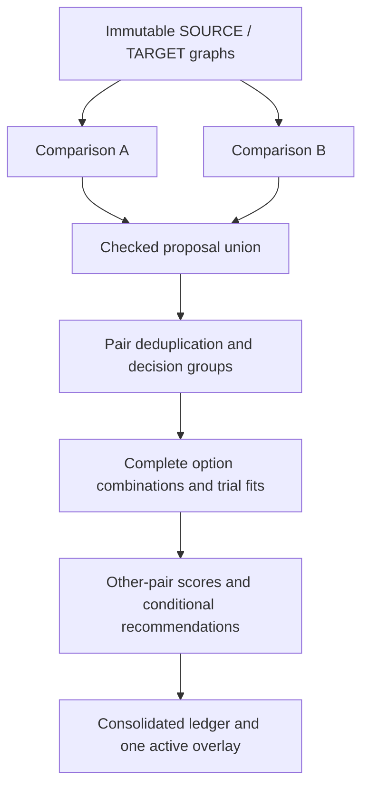

# CIIFR_GEO — Geometry correspondence: core concept and logic

**Document version:** 1.1 candidate, 26 October 2026, Asia/Dubai.  
**Purpose:** preserve the Owner's decisive product concept as a source-grounded, implementable contract.  
**Standing:** Owner-confirmed requirements plus explicitly marked engineering proposals. This document is not Owner acceptance of its new proposals, a product release, a Writer specification, or a claim that the complete algorithm already exists.  
**Author:** current CIIFR_GEO Oracle, acting as a specification contributor. Author calculations and reference probes are self-checks. Separate concept review is recorded in the accompanying review artifact; product-independent review remains separate.  
**Current product basis:** XCU draft PR [#185](https://github.com/reallakshman19/XML_Compare_Utilities/pull/185), observed exact head `668c22b49077520e911a3ef64a931c94db3a0a29`. Canonical Cycle was revision 13 when this work started. Neither record is silently advanced by this specification.

## Reading map

1. [Outcome and confirmed decisions](#1-outcome-and-confirmed-decisions)
2. [Vocabulary and identities](#2-vocabulary-and-identities)
3. [Three-tab architecture](#3-three-tab-architecture)
4. [Original geometry and coordinate contract](#4-original-geometry-and-coordinate-contract)
5. [Anchors and registration](#5-anchors-and-registration)
6. [Candidate tables and controls](#6-candidate-tables-and-controls)
7. [Consolidation and conflict groups](#7-consolidation-and-conflict-groups)
8. [Trial construction and residuals](#8-trial-construction-and-residuals)
9. [The decisive scoring rule](#9-the-decisive-scoring-rule)
10. [Multiple conflicts and nested search](#10-multiple-conflicts-and-nested-search)
11. [Conditional recommendations and cycles](#11-conditional-recommendations-and-cycles)
12. [Proposed coherent-default policy](#12-proposed-coherent-default-policy)
13. [Manual choices, ties and edits](#13-manual-choices-ties-and-edits)
14. [Consolidated geometry and viewer](#14-consolidated-geometry-and-viewer)
15. [States, snapshots and asynchronous work](#15-states-snapshots-and-asynchronous-work)
16. [Executable examples](#16-executable-examples)
17. [Failure cases and acceptance tests](#17-failure-cases-and-acceptance-tests)
18. [Implementation and verification plan](#18-implementation-and-verification-plan)
19. [Data and export contract](#19-data-and-export-contract)
20. [Decisions, risks and evidence frontier](#20-decisions-risks-and-evidence-frontier)

## 1. Outcome and confirmed decisions

The user compares one SOURCE model with one TARGET model, investigates competing alignment interpretations, chooses useful NODE correspondences, and sees the resulting comparison without losing either model's physical continuity. A plausible-looking anchor must not win merely because it makes its own residual small. It must be judged by what it does to the other correspondences.

The workbench has two independent comparison tabs and one consolidated comparison. A and B behave like separate input sessions even when they share the same immutable original XML bytes. This preserves the ability to understand each interpretation independently. Consolidated combines candidate decisions, not fragments of differently transformed pipes.

The following are the Owner's effective decisions from the conversation. Later corrections supersede earlier illustrations on the same point.

| ID | Confirmed product requirement |
|---|---|
| O01 | Focus on comparison of two existing XML geometries through Method C/manual anchors and SVG/shared 3D review. CII-to-XML construction is outside this task. |
| O02 | Reuse the robust XCU 3D Edit/Load Calc interaction capabilities where practical. Provide navigation, physical NODE selection and camera views. |
| O03 | Provide a vertical-axis selector for orbit navigation. Camera changes must not alter engineering coordinates or correspondence evidence. |
| O04 | Normal and fullscreen row selection must highlight the respective original SOURCE and TARGET NODEs. Fullscreen uses a correspondence popup. |
| O05 | Competing anchor interpretations belong in separate tabs A and B, treated as independent comparison inputs. |
| O06 | A/B tables have an inclusion checkbox beside the TARGET candidate; recommendations start checked. Candidates may be edited manually. |
| O07 | A third tab, Consolidated, is populated from checked A/B proposals and generates the consolidated overlay. |
| O08 | Merge identical SOURCE/TARGET pairs. Preserve their origins rather than counting duplicate evidence twice. |
| O09 | Unique consolidated pairs have no checkbox or option control. |
| O10 | Competing choices for one SOURCE use option/radio controls in Consolidated. A/B checkboxes remain the proposal inputs. |
| O11 | The latest instruction replaces the earlier initially-unchecked default: recommend/default-check the iteration with minimum error in the other conflict pairs. |
| O12 | Exclude the entire conflict pair/group being tested from its score, not just one visible row. |
| O13 | With multiple conflict pairs, evaluate combinations through nested iteration and give an individual recommendation for each conflict pair. |
| O14 | Keep manual override possible and make numerical disagreements intelligible. Do not turn an unresolved comparison into a blanket stop on reviewing other data. |
| O15 | Current worked anchor labels: A has `5210 ↔ 5210` and `5229 ↔ 5229`, labelled **Manual A anchor**; B has `5210 ↔ 5229`, labelled **Manual B anchor**. These replace earlier example pair labels. |

Several details needed for implementation were not explicitly decided by the Owner. They are marked **PROPOSED** below: absolute-value scoring, tie tolerance, exact search limits, rank-deficient previews, and a coherent-default policy when individual minima do not coexist. Publishing this candidate does not silently adopt those details.

## 2. Vocabulary and identities

| Term | Meaning |
|---|---|
| Original graph | The immutable, parsed physical NODE/ELEMENT graph of one input revision. |
| Physical NODE | An actual original endpoint identity with coordinates, component and witnesses. A label or a projected station is not a physical NODE. |
| ELEMENT | An original edge between physical endpoints, with its original witness. |
| Comparison/session | One A/B input-and-configuration snapshot, registration interpretation, candidate ledger and view state. |
| Anchor | An explicitly entered SOURCE/TARGET NODE constraint, carrying provenance. |
| Candidate pair | A proposed correspondence between two original physical NODE identities. |
| Inclusion checkbox | Include this proposal in Consolidated; it is not an engineering-identity approval. |
| Exact duplicate | The same SOURCE identity and TARGET identity at the same original revisions. |
| Decision group / conflict pair | All checked alternative TARGET candidates competing for the same SOURCE identity. This is the Owner's scoring-exclusion unit. |
| Custody/dependency cluster | Decision groups connected through a shared TARGET or another declared dependency. This controls joint evaluation; it does not silently enlarge the scoring-exclusion unit. |
| Iteration / trial | One complete assignment of options plus the registration fitted for that assignment. It is not just a clicked row. |
| Active option | The candidate currently chosen for a conflict group. Exactly one option per resolved SOURCE decision group. |
| Recommendation | A numerical suggestion under a named snapshot and the other current choices. It does not authenticate physical identity. |
| Manual pin | An explicit user override that fixes one group while the other groups are evaluated. |
| Residual | TARGET minus registered SOURCE, expressed in a declared common frame and millimetres. Its sign is preserved for display. |
| Score | A scalar error derived from residuals on the declared other-pair cohort. It is not a probability or confidence percentage. |

An implementable node key is at least:

```text
NodeKey = side + inputMember + originalByteSHA256 + componentId + originalNodeId
PairKey = sourceNodeKey + targetNodeKey
GroupKey = sourceNodeKey
```

The literal string `5210` is insufficient. Two files, members or components can contain that number without containing the same physical NODE. Filenames, NodeName equality, display order and coordinate coincidence must not merge distinct identities.

Candidate identity and evidence identity are separate. Two tabs can propose one PairKey using different anchor sets and poses; the pair merges in Consolidated while both evidence records remain.

## 3. Three-tab architecture

### 3.1 Independent A/B sessions

Each comparison owns:

- Its selected input revisions and parsed graph references.
- Its anchor set, registration mode, numerical fit policy and pose hypotheses.
- Its candidate ledger, signed residuals, alternatives and inclusion decisions.
- Its selected row/NODE, projection, camera, vertical axis, overlay/split setting and fullscreen/popup state.
- Its snapshot/version and export receipt.

The parsed original byte/graph objects can be shared as immutable data. A/B mutable state is isolated. Checking B must not mutate A's transform or move A's vertices. An input edit in B must not overwrite the original graph used by A.

In the present example A and B use the same F05/R4 original-derived XML pair. In a future comparison of different original files, the PairKeys cannot be combined as though they belonged to one TARGET. Consolidate by compatible input-revision set; keep separate groups/tabs for incompatible original TARGETs.

### 3.2 Consolidated is derived, with its own decisions

Consolidated consumes checked A/B proposals. It owns duplicate merging, conflict groups, radio choices/manual pins, iteration receipts, recommendations and the selected consolidated pose. It does not overwrite A/B's proposal checkboxes when a radio is chosen.

Its overlay has one fixed SOURCE and one whole registered TARGET per active iteration. Other iterations remain inspectable as named comparisons. The UI must never create a pipe by selecting vertex 1 from pose A and vertex 2 from pose B.

Opening another tab preserves the previous tab's camera and selection. Copying a camera between tabs is an explicit view operation and changes no evidence.

### 3.3 Data flow



## 4. Original geometry and coordinate contract

### 4.1 NODE/ELEMENT semantics

The current XML intake derives coordinates from declared native-mm ELEMENT vectors and coordinate seeds. Retain the original edge direction, signed deltas, components, XML record locators and input-byte hashes. Detect inconsistent cycles and seeds; do not repair them by silently averaging geometry.

A candidate must name a genuine original TARGET NODE. A closest point inside an ELEMENT is a `SEGMENT_ONLY` observation with endpoints, station/fraction and witness. It cannot receive a physical NODE pair, anchor checkbox or consolidation radio as though a new endpoint existed.

Repeated/equal coordinates do not merge physical node IDs. Disconnected components retain their own coordinate-frame qualification. Do not create one global registration from unrelated relative components without an explicit frame relationship.

### 4.2 Units and transforms

All scored coordinates and residuals are in millimetres. Verify supported profile units before comparison; retain any declared conversion and its source. A profile with unknown units is not made comparable by a camera zoom or a larger tolerance.

Choose one canonical transform direction in data contracts:

```text
F: SOURCE → TARGET
F(s) = R s + t
RᵀR = I, det(R) = +1, scale = 1
```

SOURCE-fixed graphics can render TARGET through the inverse:

```text
Q(t_node) = Rᵀ (t_node − t)
```

Both expressions describe one registration. Store its direction explicitly; do not treat source-to-target `t` as a target-to-source translation without inversion.

**Scoring-frame proposal P01:** score all iterations in the same TARGET/world XYZ axes using `t_node − F(s_node)`. A SOURCE-fixed viewer may display the equivalent vector `Rᵀ residual` in SOURCE axes, but must label it separately. Axis-wise absolute-sum error changes under rotation; therefore mixing these frames between trials is a genuine ranking bug even when Euclidean lengths agree.

The worked examples hold orientation fixed, so their two frame conventions coincide. They do not validate the general rotated case.

For a simple discriminating example, `(10,0,0)` has L1 error 10 mm. Rotating that vector 45° about Z gives `(5√2,5√2,0)` with L1 error approximately 14.142 mm while its Euclidean length stays 10 mm. Thus a screen/camera-axis residual cannot be used as the score without changing the ranking problem.

### 4.3 Continuity invariant

One rigid transform applies to every node in a rendered TARGET component. All original ELEMENT endpoints refer to those transformed nodes. Element count, endpoint identity, connectivity and length remain unchanged within numerical tolerance. Selected correspondences and residual arrows are annotations, not new physical ELEMENTs.

## 5. Anchors and registration

### 5.1 Provenance and labels

An Owner-entered anchor retains `Manual A anchor` or `Manual B anchor` and its comparison ID. Never relabel an entered anchor as merely `Recommended candidate` because it is close to a coordinate. Never give an automatic near candidate a manual label merely because its source row originated beside an anchor.

Store the original constraint separately from the editable current candidate. If `5210 → 5210` is the original Manual A anchor and the table candidate is edited to `5229`, display an edited proposal with its origin. Do not silently rewrite the anchor receipt or pretend the old A registration was fitted using the new target. An explicit anchor edit reruns A and increments its version.

Unchecking an anchor's **Include in Consolidated** checkbox removes its proposal from consolidation. It does not silently delete that anchor from the independent A/B registration. UI labels must make these two operations distinct.

### 5.2 Observability

| Available independent constraints | What can be calculated | What remains unobserved |
|---|---|---|
| No anchors | Original/unregistered view, or a separately declared discovery hypothesis | No established registered pose |
| One point pair | Translation under a retained/declared preview orientation | Three rotational degrees of freedom |
| Two distinct point pairs | Align their direction and check separation | Twist about the aligned line |
| Three well-separated noncollinear pairs | A numerical proper rigid fit | Physical identity and trusted provenance remain separate |
| Collinear/nearly collinear or coincident pairs | Only the supported subspace; optionally a declared retained-orientation preview | Missing/ill-conditioned rotations |
| Contradictory point constraints | A numerical compromise or separate hypotheses, with actual residuals | Simultaneous exact satisfaction may be impossible |

Three pairs are not automatically enough: basis geometry and conditioning matter. Avoid distant common coordinate origins degrading numerical accuracy; solve using centred coordinates and retain the origin operation in the receipt.

**Proposal P02:** when a full rigid fit is rank-deficient, continue a clearly labelled lower-rank/retained-orientation preview rather than halting the whole workbench. Never let a missing transform become an identity transform labelled verified. Trials with different fit freedoms cannot be ranked as directly comparable without an explicit policy.

### 5.3 Fit objective and score are different

The existing Method C proper rigid fit and its residual checks are the starting implementation seam. A trial fit may minimise squared distance while the Owner's recommendation score uses axis-wise absolute error on other pairs. Record both objectives. Do not quietly substitute the score for the fit objective or claim they optimise the same quantity.

Manual candidate selection means the pair participates in a trial; it does not guarantee zero residual when other constraints are incompatible. A separate **hard-anchor/pinned-transform** mode would change the fitting problem and must be an explicit policy/version, not an assumption attached to every manual row.

### 5.4 Native ordering and residual adapters

The current native two-anchor registration pins the **first** pair exactly and leaves any separation mismatch at the second. For SOURCE X coordinates `[0,10]` and TARGET `[0,12]`, order A,B gives candidate-sign residuals `[0,+2]`; order B,A gives `[-2,0]`. The existing solver therefore does not justify an order-invariance claim for incompatible two-anchor trials.

**Proposal P08:** freeze the actual solver/mode and a canonical constraint order in every trial receipt. UI row order must not become fit order. A symmetric two-point fit is an explicit alternative fit policy, not a silent replacement of current Method C. Tests must distinguish these modes and their effect on the other-pair score.

The native registration's anchor residual array uses `registered SOURCE − TARGET`, while the candidate ledger uses `TARGET − registered SOURCE`. The scoring adapter normalises these into the declared canonical sign/frame before presentation or calculation. A renderer must not guess that arrays with the same field name have the same convention.

## 6. Candidate tables and controls

### 6.1 A/B population

Generate candidates independently under each comparison's pose. Keep all physical NODE alternatives, nearest-outside-tolerance observations, ELEMENT projections and TARGET collisions distinguishable. Registration tolerance and NODE proximity tolerances are distinct quantities.

The existing table fields remain:

```text
SOURCE | TARGET candidate | Status | ΔX, mm | ΔY, mm | ΔZ, mm | Alternatives
```

The TARGET candidate cell contains an inclusion checkbox and editable ID. A recommended real NODE proposal starts checked; an entered manual anchor starts included unless the user excludes it. A nearest NODE outside the candidate tolerance is labelled nearest-only and is not automatically checked. A segment-only observation has no fabricated target NODE ID.

Checking a row includes its proposal. Clicking/focusing a row merely inspects it. These are separate events. The latter must not change checkboxes or radio choices.

### 6.2 Candidate editing

On committing an edited target ID:

1. Resolve it in the exact current TARGET graph/component.
2. Recompute that row's residual under its A/B pose.
3. Preserve the old candidate/anchor provenance in the edit history.
4. Increment proposal revision and refresh Consolidated membership, duplicates and scores.
5. Revoke stale exports/recommendations before accepting asynchronous results.

An unknown ID remains a visible invalid edit with no geometry contribution; other valid comparisons continue. Never convert an invalid or missing residual to zero. Use native DOM text/value assignment for supplied IDs; do not interpolate them as executable markup.

### 6.3 Consolidated controls

| Condition after merging checked proposals | Control and behaviour |
|---|---|
| One distinct pair with no SOURCE alternative | Include automatically; no checkbox/radio |
| Same PairKey appears in A and B | One row; `From: A, B`; no extra vote or double weight |
| Same SOURCE has different TARGET alternatives | One radio group containing the alternative rows |
| Latest scoring rule gives a valid minimum | Default-check the numerical recommendation; allow override |
| Equal score | Apply the explicit tie policy and display equal support |
| Proposal is invalid/nonfinite/stale | Keep the diagnostic visible; do not rank it as zero error |

The earlier instruction to begin conflicts unchecked was superseded by the Owner's later minimum-error default. Historical examples showing initially empty radio groups are not the final default rule.

Unique does not mean geometrically perfect or physically authenticated. A unique pair can have a nonzero residual, and it may also participate in a separate TARGET custody conflict.

## 7. Consolidation and conflict groups

### 7.1 Exact union and deduplication

Collect checked, revision-current proposals; validate their identities; merge by PairKey. Retain every originating comparison, proposal ID, pose/evidence snapshot and check decision. A duplicated pair contributes one observation to the numerical fit and score unless a future weighting policy explicitly says otherwise.

Deduplication never means merging equal coordinates, equal labels, equal target IDs across different original files, or the same SOURCE paired with two different TARGETs.

### 7.2 Exclusion unit

For SOURCE identity `s`, define:

```text
G(s) = {checked candidate PairKeys whose sourceNodeKey is s}
```

If `G(s)` contains different targets, all those alternatives form one conflict pair/group. When testing it, exclude the entire group from the scoring cohort. In a complete trial only one alternative is active anyway; every unchosen alternative is absent from both the trial fit and the score.

A row number is not the exclusion identity. Filtering, sorting, duplicate merging or a virtualised table must not change which observations are excluded. An exclusion receipt lists the GroupKey, source identity and all associated candidate PairKeys.

### 7.3 TARGET reuse and dependent groups

Two SOURCEs can claim the same physical TARGET. Detect this independently of SOURCE alternatives. Example: selecting `5210 → 5229` while retaining `5229 → 5229` creates a TARGET custody conflict. One physical target point cannot simultaneously be two distinct source positions under an exact rigid registration.

Keep both proposals and their numerical diagnostics visible. Distinguish:

- **Diagnostic trial:** may show competing geometric claims and their residuals. It is a comparison, not an accepted one-to-one transfer map.
- **Custody-consistent assignment:** no accepted TARGET identity is owned by two SOURCE identities under the one-to-one policy.
- **Engineering-accepted mapping:** requires the project's separate original-data/acceptance authority; neither of the first two states implies it.

**Proposal P03:** connect SOURCE decision groups that share TARGET candidates into dependency clusters for joint search and diagnostics. Maintain the original SOURCE-group scoring-exclusion rule. Do not exclude an entire connected cluster merely because one of its groups is clicked: that would silently remove other comparison evidence.

An assignment that violates custody is labelled `TARGET_REUSED`; do not silently drop the losing SOURCE, split the target into imaginary nodes, or call the assignment transfer-ready. Review and alternative iteration can continue. The native Method C anchor validator currently rejects duplicate TARGET custody; a diagnostic evaluator therefore needs an explicit separate observation interface before such a trial can be fitted through that engine.

## 8. Trial construction and residuals

Let `U` be the deduplicated unique pairs, and let conflict groups `G1…Gm` have option sets `O1…Om`. A complete option assignment is:

```text
α = (o1, o2, …, om), with exactly one active option oi ∈ Oi
P(α) = U ∪ {o1, …, om}
```

The selected candidate from the tested group **is included** when fitting the trial transform. Only its contribution to the subsequent recommendation score is excluded. This is an influence-on-other-pairs calculation, not a leave-one-out fit or independent held-out validation.

For each trial:

1. Bind immutable graphs, units, anchors, candidate choices and solver policy to one snapshot.
2. Classify invalid IDs, component/frame conflicts, duplicate custody, geometric rank and solver admissibility.
3. Fit the appropriate declared rigid/preview mode to `P(α)`; retain numeric residuals and limitations.
4. Compute every selected pair's signed residual in the one fixed scoring frame.
5. Score each conflict group on the other-pair cohort.
6. Retain the complete trial receipt, not just its total.

For the canonical SOURCE→TARGET pose:

```text
r_p(α) = T_p − (R_α S_p + t_α)
ΔX_p = r_p.x; ΔY_p = r_p.y; ΔZ_p = r_p.z
```

Displayed signs remain signed. Numeric score construction may use magnitudes; that does not authorise replacing signed table values with absolute values.

If no comparable pose can be evaluated, the trial has a typed `NOT_EVALUATED` result and a reason. Preserve the last valid view as explicitly stale or show original geometry; do not report a zero-score success. Other valid trials remain usable.

### 8.1 Comparable trial universes — proposal P09

Freeze the fit freedoms, solver/version, constraint ordering, orientation premise and admissibility policy **once per search job**. Classify each case explicitly:

| Trial class | Permitted interpretation |
|---|---|
| `NATIVE_ADMISSIBLE` | Evaluated through the declared native validator/solver; retain its actual rank, custody and fit limitations |
| `PREVIEW_NUMERIC` | A separately declared diagnostic fit, such as retained-orientation translation; may expose rejected custody claims numerically |
| `NOT_EVALUABLE` | Required identity, units, coordinate frame or finite numerical data is unavailable; no numeric success is invented |

A diagnostic adapter is not permission to bypass the native validator and call its output accepted anchors. A full-rigid job must not quietly use full rotation for easy options and retained-orientation translation only for difficult options, then rank the mixed scores as one fair comparison. If a preview is useful, run a separate job with that same declared preview freedom for every compared option. An explicitly designed mixed-rank policy would be another versioned proposal requiring its own validation.

The mathematical minimum is always scoped to a named universe. Keep a **diagnostic minimum** distinct from a **custody-consistent default**. A TARGET-reused trial can remain inspectable, manually selected as a diagnostic and numerically scored; it cannot receive a custody-consistent or transfer-ready label. Manual pins are preserved, and an infeasible pin context produces an honest diagnostic state rather than a silently changed choice. Missing strict trials do not become zero scores or vanish from the coverage receipt.

## 9. The decisive scoring rule

### 9.1 Primary scalar

**Owner rule:** minimise the summed coordinate errors of the other conflict pairs, excluding the whole conflict pair currently tested.

**Interpretation proposal P04, used in the demonstrations:** use absolute axis magnitudes so errors measure displacement and opposite signs cannot cancel:

```text
L1(r) = |r.x| + |r.y| + |r.z|
E_g(α) = Σ L1(r_p(α)), for p ∈ P(α) and p ∉ G_g
```

This is an unweighted sum in mm, not RMS, Euclidean distance, mean error, squared error, a maximum, or a probability. Any later weighting/normalisation is a versioned alternative, not an invisible optimisation. The expected mathematical interpretation of the Owner's phrase “summation dx+dy+dz” should be confirmed before this proposal becomes the product's normative default.

### 9.2 The fair-comparison cohort

When comparing options of group `g`, hold every other group's current choice fixed. The same other-pair identities must be evaluated in each of those counterfactuals. Include other active conflict pairs and unique pairs; do not include inactive alternative rows or duplicate copies from two tabs.

Never let an option improve its score by:

- Dropping a difficult NODE from the candidate list after changing pose.
- Searching a new nearest TARGET for every scoring witness.
- Changing tolerance or component membership between trials.
- Counting two copies of a favourable A/B duplicate.
- Replacing an uncomputable residual with zero.
- Excluding all other groups connected through a reused TARGET.

The cohort receipt contains its PairKeys, exclusion GroupKey and a hash. If a trial cannot evaluate the same cohort, mark it non-comparable or coverage-incomplete; show the affected identities. Do not compare a sum over 2 witnesses with a sum over 200 as though smaller were better evidence. A shortfall is not solved by increasing a tolerance.

### 9.3 Fit, score and evidence are distinct

The tested option may lower its own residual while worsening all the other pairs. This is exactly the wrong result the Owner's score is designed to detect. Its own residual remains visible in the table, but does not help its recommendation score.

All selected pairs can also influence the fitted pose, including the other scored pairs. Therefore a low `E_g` is geometric consistency under the declared fit, not independent physical correspondence verification. Repeated geometry and a shared wrong coordinate premise can still produce a deceptively good score.

## 10. Multiple conflicts and nested search

### 10.1 Exhaustive reference behaviour

With group option counts `k1…km`, complete assignments number:

```text
K = k1 × k2 × … × km
```

Three groups with two choices each produce eight complete assignments. Fit each assignment once, cache its pair residuals, then calculate the separate `E_g` values from that same iteration. Do not pretend eight combinations means eight independently valid rigid registrations; admissibility is classified per case.

```python
for complete_assignment in product(options_for_each_conflict_group):
    pairs = unique_pairs + one_option_from_each_group(complete_assignment)
    trial = fit_declared_registration(pairs, frozen_inputs, solver_policy)
    for tested_group in conflict_groups:
        cohort = included_pairs_except_entire_group(pairs, tested_group)
        trial.score[tested_group] = absolute_axis_sum(trial.residuals, cohort)
    retain_trial_receipt(trial)
```

For a group's individual recommendation, compare the cases differing only in that group's option, with all other current/manual choices fixed. Report the option, score, compared-pair count and score difference to the alternative.

### 10.2 Complete-search and partial-search labels

| Search state | Honest UI statement |
|---|---|
| All admissible assignments under the frozen policy were evaluated | Exact within this candidate/solver/cohort set |
| Some cases are invalid or rank-deficient | Exact only over the stated comparable subset; show exclusions |
| Worker has evaluated a subset | Best found so far; evaluated/total, never “global minimum” |
| Heuristic/beam/local search used | Approximate recommendation with search policy and budget |
| No comparable scoring witnesses | No other-pair support; equal or unknown support must be explicit |

### 10.3 Scalability proposal P05

Production search runs in a Worker with cancellation and progress. Stream combinations; avoid retaining a full geometry copy for each case. Reuse immutable graphs and fit statistics. Retain compact scores, poses, top candidates and reproducible choice vectors; recompute detailed residuals for an inspected case.

Three binary groups require 8 cases; 20 require 1,048,576; 30 require 1,073,741,824. UI responsiveness cannot depend on finishing a synchronous recursive loop. Compute total with an overflow-safe integer and make progress meaningful.

A budgeted progressive mode must keep review usable, preserve best-so-far results and state incomplete search honestly. No silent cap may produce an “exhaustive” label. A safe pruning rule needs a valid lower bound for this fit-and-exclusion objective; a nearest-node heuristic is not such a proof. Dependency clusters may be searched independently only if their fitting/scoring influence is actually independent; a shared global transform usually couples them.

## 11. Conditional recommendations and cycles

### 11.1 Why individual recommendations are conditional

Choosing group G1 can change the fitted transform and therefore the best option for G2. The product must not compute each option under a different hidden context and combine those independently best rows into an untested final state.

Every recommendation records the other-choice vector it assumes. A change to another group invalidates that recommendation and schedules a new evaluation. Manual pins restrict which joint assignments may be selected, but a pinned group's alternative can still be shown as a counterfactual recommendation without silently applying it.

### 11.2 Important mathematical limit: exhaustive search does not ensure simultaneous minima

A separate non-author reviewer constructed this exact translation-only counterexample. Let each pair's required TARGET→SOURCE translation be `d = S − T`:

```text
fixed pair: d0 = (-8, -2, -3)
G1 options: a = (-5, -8, -7), b = (-3, 6, 5)
G2 options: c = (4, -6, 4),   d = (6, 2, 1)
trial translation = mean(d0, selected G1, selected G2)
pair residual = trial translation − required translation
```

All coordinates and scores are mm. `E1` excludes the whole G1 pair and `E2` excludes G2.

| Assignment | Fitted translation | E1 | E2 |
|---|---|---:|---:|
| a,c | (-3, -16/3, -2) | 23 | 19 |
| a,d | (-7/3, -8/3, -3) | 70/3 | 55/3 |
| b,c | (-7/3, -2/3, 2) | 77/3 | 67/3 |
| b,d | (-5/3, 2, 1) | 22 | 71/3 |

The best-response sequence is `a,c → a,d → b,d → b,c → a,c`. Each move improves the moving group's own other-pair score. There is no assignment at which both groups simultaneously achieve their conditional minimum. The example can use distinct TARGET identities; it is not caused by TARGET reuse.

This means an unconditional promise to “keep iterating until every option is individually minimum” can hang or oscillate. Do not hide the issue behind an iteration limit or a message saying another pass is guaranteed to solve it.

## 12. Proposed coherent-default policy

**P06 — engineering proposal, not yet an Owner-adopted rule.** It completes the UI behaviour when the Owner's desired individual minima cannot all coexist. The implementation must expose this policy rather than invent a hidden tie-break.

For each complete assignment `α` and unpinned group `g`, define conditional regret:

```text
best_g(α_-g) = min over o ∈ Og of E_g(α_-g, o)
regret_g(α) = E_g(α) − best_g(α_-g)
```

Regret is zero when that selected option is a conditional minimum. It is not the group's own anchor residual.

An exact `best_g` requires every admissible alternative in that same-context counterfactual slice to be evaluated, using the same scoring cohort and comparable fit policy. A partial overall search may still complete a particular slice; record completeness per group/context rather than assuming it. If an alternative remains unvisited, the minimum observed so far is an upper bound on the true minimum, and the resulting observed regret is a **lower bound** on the true regret. Label it accordingly. Incomplete regrets cannot certify an exact minimum-worst-regret combination or prove that no simultaneous-minimum assignment exists. A best-found preview remains available with its coverage and uncertainty.

If no alternative is admissible in the fixed context, the minimum and regret are undefined: return `NO_FEASIBLE_CONTEXT` with the excluded trial identities/reasons. Do not store zero, choose an invalid candidate or automatically relax a manual pin. If all groups are manually pinned, there is no automatic-choice optimisation; evaluate and display that complete pinned trial with its actual fit, custody and support status.

If the selected option is the only admissible option, its regret is mathematically zero but it has no admissible challenger. Label it `NO_COMPARABLE_ALTERNATIVE` / feasibility-forced, retain the excluded alternatives and their reasons, and do not describe it as winning a numerical comparison.

1. Honour manual pins as fixed constraints on the joint choice.
2. If an assignment has zero regret for every unpinned group, select among such assignments deterministically. Numerical implementation uses the explicitly declared near-zero band from P07 and labels tolerance-based equality accordingly.
3. Otherwise propose a coherent assignment by this lexicographic ordering:
   - Minimum **maximum** regret across unpinned groups.
   - Then minimum sum of their regrets.
   - Then minimum overall absolute residual across included pairs.
   - Then fewest automatic changes from the last compatible selection.
   - Then stable canonical choice-vector ordering.
4. Retain every group's individually best counterfactual and its assumed context.
5. Label the result **Coupled compromise** when any selected unpinned group has nonzero regret. Show its regret and better individual alternative. Never label it “all individual minima.”

This chooses a stable, inspectable state without forcing the user to wait for impossible convergence. It does not change the primary per-group score; it introduces a separate rule for selecting one coherent combination.

The min-max-first choice is a real policy tradeoff. The current inline illustration used minimum **sum** regret followed by total error. An independent contrast has equal total regret 0.8 mm but:

| Candidate combination | Regrets | Worst regret | Total geometric error |
|---|---|---:|---:|
| Minimum-sum/global-error preference | (0, 0.8, 0) | 0.8 | 105.2 |
| Proposed minimum-worst-regret preference | (0, 0.4, 0.4) | 0.4 | 116.0 |

The proposed policy spreads the departure from individual recommendations at the cost of higher total geometric error in that example. It requires an explicit decision before product-default implementation. Reference probes preserve the exact inputs rather than treating this choice as self-evident.

## 13. Manual choices, ties and edits

### 13.1 Manual pin lifecycle

A radio click creates a user choice with group identity, candidate PairKey, snapshot and timestamp. It is not just a Boolean on a display row. Keep the chosen option active even if it is not recommended; show the recommendation, score difference and manual-override label beside it.

Recompute recommendations for other groups after a manual change. Never silently undo a manual pin to make an optimisation score better. If the chosen candidate disappears, the source/target revision changes, or its group identity changes, mark the pin stale and require a new explicit selection; do not bind the old choice to an equal-looking ID in new data.

Checking/unchecking an exact duplicate origin changes provenance, not its numerical weight. It must not erase an unrelated group's manual choice. Editing another group's candidate requires rescore but does not by itself make a surviving manual pin disappear; record whether it was reconfirmed under the new context.

### 13.2 Tie policy P07

Compare unrounded scores. Proposed score tie tolerance is `1e-6 mm`, independently versioned from geometric candidate tolerance and fit-rank tolerance. Display rounding to three decimals never decides a tie.

For a complete comparable option slice, first compute its numerical minimum `b`; define equal minima as `E(o) <= b + epsilon`. Do not use a pairwise “within epsilon” sorting comparator: it is not transitive. Keep raw regrets and scores in the receipt; treat `0 <= regret <= epsilon` as near-zero support under the declared tolerance, not proof of exact mathematical equality. For the P06 lexicographic choice, apply the same minimum-relative band separately to each mm-valued stage, retaining its survivors before the next stage; integer change counts and canonical keys use exact ordering. Freeze the tolerance in the search snapshot. These numerical conventions are proposed policy, not Owner-confirmed mathematics.

For equal supported minima, retain an existing compatible user choice, then the last compatible automatic choice, then use a deterministic stable choice key. Mark equal support; do not imply one is geometrically proven better. When there are no other included pairs, all zero sums have **zero witnesses** and provide no recommendation evidence; a deterministic display default must say so.

A nonzero witness count also does not guarantee discrimination. For example, if the fit policy pins the only other pair exactly, every tested option may obtain zero other-pair error by construction while having a large residual at the tested pair. Display equal/non-discriminating support. Using the tested pair's own residual to break that tie would be a new explicit policy, because the Owner excluded it from the primary score.

### 13.3 Invalidation rules

| Event | Required effect |
|---|---|
| Camera, orbit axis, popup move, row inspection | View only; no numerical recomputation or evidence revocation |
| A/B inclusion checkbox | Rebuild checked union and dependent scores; preserve A/B registrations |
| Candidate ID edit | Revalidate identity, dedup/group membership, recommendations and consolidated pose |
| Anchor change in A or B | New comparison snapshot, registration/candidates, downstream proposal revision |
| SOURCE/TARGET file revision | Rebind identities, revoke old candidates/pins/exports for affected data |
| Numeric mode/tolerance/unit/profile change | New policy snapshot; invalidate dependent fit, candidate or score results explicitly |
| Manual radio choice | Pin that group, evaluate the compatible joint context, update overlay and other recommendations |
| Stale Worker completion | Ignore its numerical and UI side effects, including finally/cleanup and export enabling |

This table specifies the intended separation for the new workbench. The current single-session prototype revokes its preview epoch on projection changes; separating numerical evidence validity from view/render requests is implementation work, not a claim that current behaviour already satisfies this contract.

## 14. Consolidated geometry and viewer

### 14.1 One active coherent pose

Consolidated's active overlay is generated from original graphs and the complete selected iteration. It contains one SOURCE and one whole TARGET. The table, residual arrows and exports must use that same trial ID and transform.

Rows from A/B have historical pose-specific residuals. Store those as origin evidence. Consolidated recalculates a **consolidated residual** under the active iteration and labels it accordingly. Never copy A's zero into C after C's transform changes, or mix a B-origin zero with A's geometry while showing one unlabeled Δ column.

Switching a candidate can legitimately change the fit and all consolidated residuals. The Owner's iteration score decides whether that change is a good default by measuring its effect on the other pairs. Preserve the before/after trial comparison and numerical explanation; do not describe all such changes as data corruption.

### 14.2 Rendering and selection

Use the existing shared XCU viewer backend/Worker where compatible. The correspondence ledger is independent of SVG/WebGL rendering. SVG supplies faithful projections/exports; the 3D viewer supplies navigation and picking. Neither renderer owns match decisions.

- Keep SOURCE and TARGET distinguishable by colour plus shape/line style.
- Keep visible NODE sizes and stroke contrast usable across zoom levels.
- Row click highlights the exact physical pair, including an explicitly requested target outside proximity tolerance.
- An unselected alternative has comparison styling rather than the same selection emphasis as the active pair.
- Coincident nodes have separately identifiable rings/labels; do not merge their identities into an unexplained `S + A` marker.
- Full views and close-ups preserve physical coordinates. A real overlap is not made visually separate by an unlabeled cosmetic coordinate offset.
- Split panels share camera orientation, millimetre scale and coordinate bounds; independent recentering must not conceal displacement.
- Residual arrows are labelled annotations. ELEMENT continuity remains unchanged.
- An unlinked TARGET NODE can be selected and inspected without inventing a SOURCE counterpart.

### 14.3 Navigation/fullscreen

Provide fit all, fit selected pair, orbit, pan, zoom, standard camera views, perspective/orthographic state and previous view. A visible vertical-axis choice controls camera-up/orbit semantics, not registration. The existing shared viewer currently normalises Y/Z vertical axes; X support is an implementation extension, not already-delivered capability.

Fullscreen keeps the same viewer/table identity and selection. The correspondence table becomes a movable/resizable popup, clamped to current viewport bounds. Closing/reopening or leaving fullscreen retains selections. Native fullscreen refusal falls back to an honestly labelled expanded viewport; a failed exit must not claim the browser has left native fullscreen.

## 15. States, snapshots and asynchronous work

### 15.1 Minimum state model

```text
InputSnapshot: original hashes, profile, units, members, component/frame IDs
ComparisonSnapshot: inputs + anchors + registration/candidate policy + revision
ProposalRevision: checked/edited A/B proposal records
ConsolidationSnapshot: deduped pairs + groups + manual pins + scoring/search policy
TrialId: consolidation snapshot + complete choice vector + fit hypothesis ID
RecommendationId: trial context + tested GroupKey + cohort hash + search coverage
ViewState: active tab/trial, projection, camera, selected physical identities, popup
```

Hash identity is not only a filename. An epoch is not only a camera version. Use distinct numerical and view revisions so a camera move neither invalidates source evidence nor makes old source data look current.

### 15.2 Worker request ownership

Every asynchronous search/render request carries its snapshot and request ID. Only the current owner may publish a result, update progress, enable downloads or dispose the active viewer. Cancellation revokes old ownership before starting a new request. An obsolete success, rejection or finally callback cannot clean up a newer active/pending viewer.

Show which results are current, recalculating, partial, invalid or stale. Retained last-valid results stay visibly stale and cannot be exported as the new current answer.

### 15.3 Search and rendering cost

Reuse original graph buffers across tabs and trials. A/B/C need separate state, not three redundant copies of large original XML text and every geometry buffer. Use instancing or whole-model matrices for views. Compute poses/scores in the Worker and send compact receipts; send detailed rows on demand. Virtualise large tables without making off-screen rows disappear from the cohort or exports.

Performance limits for another project do not automatically become CIIFR limits. Establish CIIFR input/graph/case budgets from measured target fixtures. A large case should receive progress, cancellation and a truthful partial result rather than a frozen browser or false exact minimum.

## 16. Executable examples

### 16.1 Public-derived original fixture basis

The preview XMLs represent the **same** public S1 geometry in two profiles, not two independent engineering models:

| File | Bytes | SHA-256 |
|---|---:|---|
| S1-F05.xml | 882735 | `1154c980d08344b1f803cda3bd9884b169753148b150641a745c9bfcb15de995` |
| S1-R4.xml | 1426775 | `a332dd7b2551faae51de3c016941762c3b795cdf19073b373817354e309526e6` |

Each parsed geometry has 57 physical NODEs and 56 ELEMENTs. The source fixture manifest is in the exact XCU candidate under `prototypes/ciifr-map/tests/fixtures/manifest.json`. This document republishes only a few already-public numeric witnesses, not protected customer files.

| NODE | X, mm | Y, mm | Z, mm |
|---|---:|---:|---:|
| 5210 | 796867.2 | 102409.6 | 1329978 |
| 5220 | 796389.2 | 102409.6 | 1329977.8500209 |
| 5229 | 796198.2 | 102409.6 | 1329977.8500209 |

The original ELEMENT from 5220 to 5229 has signed delta `(-191, 0, 0)` mm. The difference between SOURCE 5210 and TARGET 5229 is `(669, 0, 0.1499791)` mm. Those are different physical pairs.

### 16.2 The Owner's two screenshots are trial iterations

Retain two other pairs: `5220 → 5220`, `5229 → 5229`. Test G5210's alternatives `5210 → 5210` and `5210 → 5229`.

With fixed orientation and equal-weight least-squares translation:

| Tested option | TARGET→SOURCE translation | Residual of tested pair | Residual of each other pair | E_G5210 over the two other pairs |
|---|---|---|---|---:|
| A: 5210 → 5210 | (0, 0, 0) | (0, 0, 0) | (0, 0, 0) | 0 |
| B: 5210 → 5229 | (223, 0, 0.049993033) | (-446, 0, -0.099986067) | (223, 0, 0.049993033) | 446.099986067 |

The tested B pair still participates in fitting the mean translation. Its residual does not enter its score. The unselected A/B alternative is not a scoring witness. The minimum other-pair score recommends A. This reproduces the displayed `223 / 0 / 0.050` and `-446 / 0 / -0.100` values rather than dismissing their arithmetic as wrong.

The B trial also reuses TARGET 5229 across two SOURCEs. That custody diagnostic remains visible; the translation calculation does not turn it into an accepted physical mapping.

### 16.3 Three-group nested illustration

To demonstrate three groups, the inline design additionally offered `5220 → 5229` and `5229 → 5220` as explicitly labelled example alternatives. They were not entered by the Owner as new manual anchors.

```text
G5210: 5210→5210 or 5210→5229
G5220: 5220→5220 or 5220→5229  [second option is an example]
G5229: 5229→5229 or 5229→5220  [second option is an example]
```

Under the all-A context, the other-pair scores are:

| Group | A option score | Alternative score | Other active pairs counted |
|---|---:|---:|---:|
| G5210 | 0 | 446.099986067 | 2 |
| G5220 | 0 | 127.333333333 | 2 |
| G5229 | 0 | 127.333333333 | 2 |

Eight translation-diagnostic combinations were evaluated in the inline illustration. **They are not eight valid current Method C rigid anchor sets.** The separate reviewer found that six reuse TARGET custody; the remaining two unique-custody sets fail the existing default noncollinearity threshold. A production implementation must make the rank-aware preview/custody boundary explicit and test it; direct engine reuse is not already proved by this illustration.

### 16.4 Independent cycle and fallback probes

The accompanying standard-library Python probe reproduces the screenshot arithmetic and three-group scores, checks the whole-group exclusion rule, and verifies the cycle in section 11. It also preserves the fairness-policy contrast in section 12. These are mathematical/reference checks, not WebGL, browser, original private-CII, physical-correspondence or product acceptance tests.

## 17. Failure cases and acceptance tests

The following matrix is a minimum discriminating specification. Implementers must predict the outcome before running the candidate and keep failed/untested cases distinct.

| ID | Case | Required observable result |
|---|---|---|
| ID01 | Same node number in different file revisions | Separate identities; stale pair cannot bind to replacement bytes |
| ID02 | Equal coordinates with different original NODE IDs | Keep both physical NODE identities and alternatives |
| ID03 | ELEMENT interior is closest | Segment observation only; no manufactured NODE/anchor option |
| ST01 | Select B, then return to A | A's pose, selected row, camera and check state remain intact |
| ST02 | Uncheck Include in Consolidated | Proposal removed; independent anchor/registration not silently deleted |
| ST03 | Edit a candidate originating from an anchor | Edited proposal distinguished from the original anchor receipt |
| DU01 | Same PairKey checked in A and B | One consolidated observation with two origins and one numerical weight |
| DU02 | Only one duplicate origin unchecked | Pair remains while another checked origin survives |
| DU03 | Same SOURCE, different TARGETs | One decision group; radio alternatives; no double active SOURCE option |
| DU04 | Unique pair | Included automatically; no checkbox/radio in Consolidated |
| CU01 | Two SOURCEs share a TARGET | TARGET reuse shown; no silent evidence deletion or transfer-ready claim |
| CU02 | Custody dependency links groups | Joint dependency retained; score exclusion stays the tested SOURCE group |
| CU03 | Only one option survives the declared custody/fit policy | Feasibility-forced, not a numerical win; excluded challengers retained |
| SC01 | Opposite signed residuals | Magnitude score does not cancel them into zero |
| SC02 | Own anchor improves, other pairs worsen | Recommendation uses other-pair score, not the tested pair's own residual |
| SC03 | Entire tested group excluded | All its alternatives absent from score; row sorting/filtering has no effect |
| SC04 | Unchecked/unchosen alternative has a huge residual | It is not counted as an extra scoring witness |
| SC05 | Candidate moves a witness outside tolerance | Witness remains scored at its fixed identity; it does not vanish |
| SC06 | Same pair has duplicate provenance | Neither fit weight nor score cohort count doubles |
| SC07 | Rotated source-fixed display | Scoring remains in the fixed declared axes; display-vector rotation cannot change rank |
| SC08 | Score differs below display precision | Compare unrounded values under explicit tie tolerance |
| SC09 | No other pairs | Zero witnesses disclosed; deterministic default is not called independent support |
| SC10 | Scores 0, 0.75 epsilon, 1.5 epsilon | Minimum-relative tie band includes only the first two; no chained pairwise tie |
| MC01 | Three binary conflict groups | Eight complete assignments; separate per-group scores and context IDs |
| MC02 | Manual option pinned | Never auto-overwrite it; other recommendations refresh under that context |
| MC03 | Individual best-response cycle | Terminates with honest conditional/coupled result; no infinite loop or false all-minimum claim |
| MC04 | Search budget interrupted | Best-so-far/coverage shown; no exact/global-minimum claim |
| MC05 | Invalid/rank-deficient trial | Typed diagnostic; no zero score and no invented identity transform |
| MC06 | Visited option scores 5 and 7 mm; an unvisited option later scores 1 mm | The 5 mm option's provisional zero regret was only a lower bound; completed regret is 4 mm; no earlier exact coupled-optimum claim |
| RG01 | One anchor | Retained orientation visibly unobserved; translation preview works within scope |
| RG02 | Two anchors with unequal spacing | True residual/mismatch shown; no scale/stretch to force both exact |
| RG03 | Nearly collinear 3+ constraints | Conditioning/status recorded; no full-rotation claim from pair count alone |
| RG04 | Reflection would fit better | Proper-rotation policy retained; reflection not silently enabled |
| RG05 | Reverse incompatible two-anchor input order | The fit order/policy is explicit; UI sorting cannot silently change it or the score |
| RG06 | Other witness is hard-pinned by the solver | Zero scores are labelled tied/non-discriminating; own residual is not silently used as the primary score |
| RG07 | Options differ in native fit admissibility | Preserve diagnostics; compare only the declared common fit universe; no hidden per-option fallback |
| GE01 | Any radio choice/iteration | All original TARGET ELEMENT endpoint relationships and lengths preserved |
| GE02 | Before/after trial comparison | Table, arrow, transform and export agree on the same trial ID |
| GE03 | Origin A/B residual versus consolidated residual | Correctly labelled; no historical zero displayed as current overlay error |
| UI01 | Normal/fullscreen row click or keyboard selection | Exact SOURCE/TARGET physical nodes highlighted; check/radio choice unchanged by inspection |
| UI02 | Direct TARGET NODE without SOURCE row | Original TARGET inspectable; no fabricated SOURCE correspondence |
| UI03 | Vertical axis/camera change | Orbit changes only view; numerical snapshot and export evidence unchanged |
| UI04 | Popup resize/viewport shrink | Popup remains reachable; columns scroll internally; selected row preserved |
| AS01 | Obsolete Worker resolves/rejects after newer request | Cannot paint, enable stale export, change status or dispose current viewer |
| EX01 | Export after input/choice mutation | Old snapshot revoked; new export exactly describes current evidence/coverage |
| SE01 | Hostile XML/SVG/text input | No executable injection, DTD/entity expansion or trust promotion |

## 18. Implementation and verification plan

These are proposed connected slices under the existing Geometry workstream, not new adopted WBS numbers or permission to start unrelated work.

| Slice | Runnable outcome | Reuses | Required check |
|---|---|---|---|
| CORE-1: independent comparisons | A/B sessions on existing XMLs with correct anchor labels, state isolation and checkbox proposals | Current XML intake, graph, shared viewer and ledger | Actual tab switching, stale inputs, physical picks and unchanged original hashes |
| CORE-2: consolidation | Checked union, exact duplicates, provenance, unique/no-control rows, conflict radio groups and manual edits | CORE-1 proposal records | Node-key collisions, duplicate weights, whole-group identities and TARGET reuse |
| CORE-3: reference trial/scoring engine | Complete choices, rank/custody classification, full-precision per-group scores on fixed cohorts | Existing Method C solver seams, mathematical probe | Screenshot arithmetic, frame invariant, no dropped witnesses, native rank/custody counterexamples |
| CORE-4: recommendations/search | Nested cases, conditional scores, manual pins, exact/partial labels and explicitly adopted coupled policy | CORE-3 receipts | Independent enumeration, cycle witness, tie/fallback cases and cancellation |
| CORE-5: integrated overlay/export | One continuous active pose with linked table, fullscreen popup and reproducible evidence | Current SVG/shared 3D renderer plus CORE-4 | Served browser/GPU/Owner trial and exact-head independent assessment |

The next two connected useful deliveries are CORE-1 and CORE-2: the first establishes independent session/proposal state, and the second consumes those exact records. CORE-3 can be developed as a disjoint pure scoring/reference slice after its contract is reconciled. Do not replace a current accepted baseline or silently reuse another active PR's owned files.

Suggested pure module boundaries are `comparison-session`, `proposal-ledger`, `consolidation-groups`, `trial-fit`, `residual-cohort`, `iteration-search`, `recommendation-policy`, `evidence-export` and a renderer adapter. These are design seams, not a demand to create eight unused files before the first runnable slice. Existing naming/size standards and real file ownership govern the eventual implementation.

### Evidence levels

1. **Mathematical derivation:** supplied expectation and contrary example.
2. **Reference execution:** exact fixture/probe output; not product code.
3. **Native integrated execution:** actual shared engine and application lifecycle at an exact head.
4. **Served browser/GPU observation:** actual loaded XML, picking, camera, overlays, fullscreen and downloads.
5. **Separate consequential review and Owner trial:** actual scope, evidence and limits recorded.

A later level does not follow from a larger test count at an earlier one. Historical native review of PR185 does not approve newly designed consolidation logic.

## 19. Data and export contract

Minimum logical records, with implementation-specific serialisation left to the builder:

```text
CandidateEvidence {
  pairKey, sourceNodeKey, targetNodeKey,
  comparisonId, comparisonRevision, anchorReceiptIds,
  candidateKind, originPoseId, originSignedResidualMm,
  checkedForConsolidation, userEditReceipt, xmlWitnesses
}

ConflictGroup {
  groupKey, sourceNodeKey, alternativePairKeys,
  dependencyClusterId, membershipRevision
}

TrialReceipt {
  trialId, inputSnapshotId, completeChoiceVector,
  manualPins, fitPolicyVersion, transformDirection, scoringFrame,
  trialUniverseId, trialClass, fitFreedoms, fitStatus, rank, conditioning, R, t, unitScale,
  selectedPairKeys, custodyDiagnostics,
  perPairSignedResidualMm, perGroupExcludedPairKeys,
  perGroupCohortHash, perGroupScoreMm, witnessCounts,
  solverDiagnostics, searchCoverage
}

RecommendationReceipt {
  groupKey, contextChoiceVector, candidateTrialIds,
  perOptionOtherPairScoreMm, equalMinima,
  recommendedPairKey, chosenPairKey, manualOverride,
  coherentPolicyVersion, perGroupRegretMm, regretBoundKind,
  counterfactualSliceCoverage, coupledStatus,
  sourceSnapshotId, createdEpoch
}
```

JSON is the complete reproducibility export. CSV should include flat pair rows with original identities, origins, candidate/anchor labels, included/chosen/recommended status, current and origin pose IDs, signed residuals, per-group score/cohort count, custody status, policy versions and search coverage. A CSV row alone need not contain every alternative; give a joinable group/trial ID and export the companion ledger.

An SVG/scene export binds to one named active trial with physical scale/projection labels. Camera-only settings do not change match evidence. Exported coordinates must state their frame and transform direction.

No export contains private chat URLs, secrets or unapproved customer data. Safe source hashes/record witnesses are distinct from permission to publish raw originals. XML/JSON receipts are untrusted claims until checked against the original loaded bytes and supported profile.

## 20. Decisions, risks and evidence frontier

### 20.1 Decisions to preserve

| Topic | Current disposition |
|---|---|
| Independent A/B and Consolidated | Owner-confirmed concept |
| Latest manual anchor labels/pairs | Owner-confirmed, as O15 |
| Whole conflict-group exclusion | Owner-confirmed, implemented in reference illustrations only |
| Minimum other-pair default and nested combinations | Owner-confirmed outcome; full product implementation pending |
| Absolute L1 interpretation and fixed scoring frame | Explicit engineering proposals P04/P01 |
| Rank-deficient retained-orientation preview | Engineering proposal P02; current native seam requires work |
| TARGET custody/dependency treatment | Explicit diagnostic and identity distinction; proposed cluster policy P03 |
| Exact/progressive Worker search | Engineering proposal P05; no production performance qualification claimed |
| Simultaneous-minima cycle handling | Necessary mathematical limitation demonstrated; proposed P06 is not yet Owner-adopted |
| Tie/zero-witness policy | Engineering proposal P07 |
| Native two-anchor order and residual-sign adapter | Engineering proposal P08 plus source-observed solver behaviour |
| Comparable fit universes and diagnostic/default distinction | Engineering proposal P09; preserves native validator and truthful partial-search claims |
| Physical identity, field transfer, CII writing | Not granted by Geometry correspondence; separate future task/authority |

### 20.2 Current implementation truth

The published PR185 code provides a single XML preview session, Method C/manual registration, a correspondence ledger, SVG/shared 3D bridge, navigation commands, node selection and fullscreen shell. Its live head was independently fetched for this task. Canonical Cycle revision 13 still records the actual browser/GPU/Owner trial frontier.

The conversation illustrations add A/B/C concepts, checkbox/radio state and translation-only scoring over a small public fixture subset. They are explanatory prototypes outside the published product PR. Some native-like interaction checks ran in controlled DOMs, not a loaded GPU browser. They also used diagnostic combinations that the current native rigid anchor validator rejects. Do not describe them as shipped, independently accepted full Method C consolidation.

The separate concept reviewer derived the cycling counterexample and native-admissibility findings. These challenge a shared premise; they are useful independent reasoning within a bounded read-only review. They are not a separate-account GitHub APPROVE, blinded external audit, Owner decision, or engineering release.

### 20.3 Highest risks and discriminating checks

1. **Self-validating anchors:** a wrong option wins by its own zero. Use SC02/SC03 and the screenshot calculation.
2. **False complete search:** a capped/heuristic loop claims a global minimum. Retain search coverage and a known unvisited winning case.
3. **Incompatible individual minima:** a cycle causes oscillation or hidden compromise. Preserve the exact section-11 counterexample and expose the adopted selection policy.
4. **Frame-dependent rankings:** L1 score rotates with display axes. Verify fixed scoring axes under camera and SOURCE-fixed render inversion.
5. **Custody/coverage gaming:** TARGET reuse or discarded witnesses produces a smaller sum. Keep a fixed cohort and separate feasibility/custody diagnostics.
6. **Rank/provenance inflation:** three almost-collinear points or same-source F05/R4 agreement called a qualified 3D mapping. Test actual native solver rank and an independent model pair separately.
7. **Broken geometry:** mixed-pose vertices or snapped nodes give a visually good but invented pipe. Assert original edge endpoints/lengths and one transform per component.
8. **Stale choices/results:** old pins, Worker results or exports bind to changed inputs. Use snapshot ownership and real delayed-completion falsifiers.

### 20.4 Sources and authority

- Current [CIIFR Cycle](https://github.com/reallakshman19/Common/blob/main/oracle-cycles/ciifr/CURRENT.json): live control frontier, not proof of new mathematics.
- Current [START_HERE](https://github.com/reallakshman19/Common/blob/main/skills/agent-work/START_HERE.md), [Contribution/Handoff](https://github.com/reallakshman19/Common/blob/main/skills/agent-work/CONTRIBUTION_HANDOFF.md), [Independent Review](https://github.com/reallakshman19/Common/blob/main/skills/agent-work/independent-review/SKILL.md): process and claim boundaries.
- Existing CIIFR [Concept](CONCEPT_NOTE.md), [Complex Architecture](ARCHITECTURE_COMPLEX_LOGIC.md), [Decisions/Challenges](ARCHITECTURE_DECISIONS_AND_CHALLENGES.md), [Handover](ORACLE_HANDOVER.md): inherited project knowledge. Their older snapshots are not overwritten by this candidate.
- Exact XCU source `668c22b49077520e911a3ef64a931c94db3a0a29`: [`compare.js`](https://github.com/reallakshman19/XML_Compare_Utilities/blob/668c22b49077520e911a3ef64a931c94db3a0a29/prototypes/ciifr-map/compare.js), [`xml-intake.js`](https://github.com/reallakshman19/XML_Compare_Utilities/blob/668c22b49077520e911a3ef64a931c94db3a0a29/prototypes/ciifr-map/xml-intake.js), [`registration`](https://github.com/reallakshman19/XML_Compare_Utilities/blob/668c22b49077520e911a3ef64a931c94db3a0a29/tabs/cii-workspace/cii-workspace-method-c-registration.js), [`rigid fit`](https://github.com/reallakshman19/XML_Compare_Utilities/blob/668c22b49077520e911a3ef64a931c94db3a0a29/tabs/cii-workspace/cii-workspace-method-c-rigid-fit.js), [`candidates`](https://github.com/reallakshman19/XML_Compare_Utilities/blob/668c22b49077520e911a3ef64a931c94db3a0a29/tabs/cii-workspace/cii-workspace-method-c-candidates.js), and [`fixture manifest`](https://github.com/reallakshman19/XML_Compare_Utilities/blob/668c22b49077520e911a3ef64a931c94db3a0a29/prototypes/ciifr-map/tests/fixtures/manifest.json).

**Next actor:** Oracle/Owner reconciles the explicitly proposed policies against this complete concept; the next bounded builder slice is independent A/B session/proposal state. The concept can be reviewed and improved immediately. No CII writer, product merge, deployment, new Oracle cutover or blanket project stop is created by this document.
