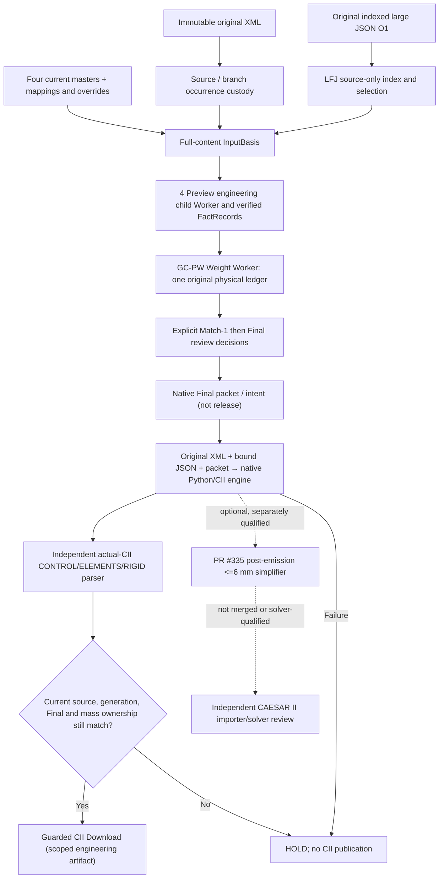

# 3DC-XML-CII — Architecture and difficult engineering logic

**Public-safe technical transfer | Source inspection at 3D main `40f11e3f6051086b1bcfcb64f2dd07b12fcb232c`; PR #335 `73da06327a9befd05cb66fe96a1dee63e6a8249e` | Oracle-prepared, SELF_ASSESSED.**
This document reconstructs *what the current source does* and why important restrictions exist. Where an older architecture file calls its component a PROPOSAL or historical snapshot, it does **not** independently establish currently deployed behavior. Read original modules linked below before changing logic. See [concept note](CONCEPT_NOTE.md), [decision/challenge register](ARCHITECTURE_DECISIONS_AND_CHALLENGES.md), and [handover landing](ORACLE_HANDOVER.md).

## 1. Trust-boundary system view



This is a **conceptual data/trust diagram**, not proof every depicted worker is deployed as an independent physical process. The [G1 lease research](https://github.com/reallakshman19/3D_Converters/blob/40f11e3f6051086b1bcfcb64f2dd07b12fcb232c/docs/architecture/xml229-g1-live-lease-contract.md) observed historical combined Worker/module execution and required an independent-process decision. Read live code and runtime traces to assess actual Worker separation; do not infer process independence from code module names.

**Primary production seams**:
- [Indexed original blob Worker](https://github.com/reallakshman19/3D_Converters/blob/40f11e3f6051086b1bcfcb64f2dd07b12fcb232c/tabs/xml-cii-2019-standalone/integration/xml229-original-blob-gcpw-worker.mjs)
- [LFJ byte-oriented tokenizer](https://github.com/reallakshman19/3D_Converters/blob/40f11e3f6051086b1bcfcb64f2dd07b12fcb232c/lfj/tokenizer/README.md)
- [GC-PW InputBasis and Fact contract](https://github.com/reallakshman19/3D_Converters/blob/40f11e3f6051086b1bcfcb64f2dd07b12fcb232c/contracts/gc-pw-v1/contract.mjs)
- [Original physical occurrence bridge](https://github.com/reallakshman19/3D_Converters/blob/40f11e3f6051086b1bcfcb64f2dd07b12fcb232c/contracts/gc-pw-v1/occurrence-bridge.mjs)
- [Run hold/readiness projection](https://github.com/reallakshman19/3D_Converters/blob/40f11e3f6051086b1bcfcb64f2dd07b12fcb232c/tabs/xml-cii-2019-standalone/integration/xml229-run-hold-audit.mjs)
- [Guarded native candidate](https://github.com/reallakshman19/3D_Converters/blob/40f11e3f6051086b1bcfcb64f2dd07b12fcb232c/tabs/xml-cii-2019-standalone/ui-adapted/xml229-native-cii-candidate-run.mjs)
- [Independent native CII reconciler](https://github.com/reallakshman19/3D_Converters/blob/40f11e3f6051086b1bcfcb64f2dd07b12fcb232c/converters/xml-cii2019-core/xml229-native-cii-independent-reconciliation.mjs)
- [Runtime converter](https://github.com/reallakshman19/3D_Converters/blob/40f11e3f6051086b1bcfcb64f2dd07b12fcb232c/converters/xml-cii-2019-standalone/engine.js)
- [Short-element spec on PR #335](https://github.com/reallakshman19/3D_Converters/blob/73da06327a9befd05cb66fe96a1dee63e6a8249e/docs/cii2019-short-element-simplification.md)

## 2. O1 original large JSON: lexical identity and bounded ownership

**WHY:** Loading giant original JSON into one UI `JSON.parse`/duplicated object tree loses responsiveness and can obscure repeated source occurrences. The Owner's O1 threshold is **100 MiB / up to 2 million occurrences with clear fail beyond**; no benchmark acceptance for that threshold is inferred from source inspection.

[LFJ tokenizer design](https://github.com/reallakshman19/3D_Converters/blob/40f11e3f6051086b1bcfcb64f2dd07b12fcb232c/lfj/tokenizer/README.md) handles bounded asynchronous original byte pages: original byte offset spans `[startByte,endByteExclusive)`, escaped keys and JSON grammar, source revision + SHA, cancellation/EOF. It enforces token/key/depth/resource limits rather than silently holding an unbounded AST; numeric original lexemes need not be rounded by JS. A complete parsed source is **source syntax** only.

[LFJ committed selection](https://github.com/reallakshman19/3D_Converters/blob/40f11e3f6051086b1bcfcb64f2dd07b12fcb232c/lfj/query/selection/README.md) operates over original occurrence IDs, parent ancestry and source-ordered pages; `ALL|NONE|EXPLICIT` selection binds `sourceRefId,sourceSha256,sourceRevision`. Nested exclusions override descendant inclusion. Provisional sink pages are not accepted until terminal `complete:true`; a claimed committed index is only trustworthy if storage actually enforced the source revision. **Rights remain `SOURCE_FACTS_ONLY`, `engineeringReady:false`**.

**Wrong cases to challenge:** same-name different occurrences collapse; escaped-key alias produces duplicate; stale index after source mutation; a truncated stream emits complete; sink exposes partial pages; cancellation produces a success result; 100 MiB case freezes despite small-test CI PASS. Test original-byte / wrong-revision contrasts, not filename/row-count equality.

## 3. O2 Preview: one immutable full-content engineering basis

`InputBasis` is constructed from actual source XML content, staged original JSON, selected source/scope, **all four master row/mapping contents and revisions**, config and overrides. [GC-PW validator](https://github.com/reallakshman19/3D_Converters/blob/40f11e3f6051086b1bcfcb64f2dd07b12fcb232c/docs/architecture/gc-pw-v1.md) uses SHA-256 content digests (not filename, file length, or counts); same-length source edits and same-count changed masters MUST invalidate the basis.

Canonical physical identity is equivalent to:

```text
physicalOccurrenceId = JSON.stringify([
  sourceId, branchOccurrenceIndex, originalNodeOrdinal, componentSignature
])
```

([Occurrence bridge](https://github.com/reallakshman19/3D_Converters/blob/40f11e3f6051086b1bcfcb64f2dd07b12fcb232c/docs/architecture/gc-pw-v1-occurrence-bridge.md)). This is **not** just `NodeNumber`. Two original source-local occurrences may have identical `NodeNumber=-1` or duplicated branch names while denoting different physical components. Mode A source boundaries and Mode B lineage are explicit responsibilities. An independent enumerator supplies the expected *original population*, and a separate physical census supplies expected physical groups.

The present verified Output/Run completion contract checks **seven engineering FactRecords per physical occurrence** and a counted universe. At the specific Owner-reported session **100 physical × 7 = 700** verified fields; this is a *session-specific witness*, not an invariant that every input always has 100 items. Physical group and node occurrence counts are different universes.

Fact status/provenance must distinguish `source`, `proposed`, `unresolved`, `conflict` and actually accepted values. Paged view completion is not full population completeness; a producer cannot nominate its own lower expected total and pass. [Current verified Run completion code](https://github.com/reallakshman19/3D_Converters/blob/40f11e3f6051086b1bcfcb64f2dd07b12fcb232c/tabs/xml-cii-2019-standalone/integration/xml229-verified-output-readiness.mjs) checks receipt schema, original JSON SHA/generation, source/basis, exact 7×fact count and four exclusive mass-state counters.

**Wrong cases:** first visible page passes as full population; field gets a suggested master value but no source authority; two equal NodeNumber rows merge; stale same-count Piping Class mapping remains accepted; Preview child output is only `source engineeringReady:false` but UI paints green; phase reuses old requestId.

## 4. O3 Weight Match/Final: mass approval is a state machine

The four live tally categories are `source`, `match1`, `final`, `unresolved`; they sum to `physicalCount`. A ranked or inferred weight may be a **proposal** only. Match-1 acceptance and Final review are distinct decisions. The [GC-PW contract](https://github.com/reallakshman19/3D_Converters/blob/40f11e3f6051086b1bcfcb64f2dd07b12fcb232c/docs/architecture/gc-pw-v1.md) defines strict command scope, expected revision, disallows duplicate decisions and requires explicit manual mass; command CAS/persistence must be guaranteed by the actual store, not presumed from a validator.

The [Output/Run verifier](https://github.com/reallakshman19/3D_Converters/blob/40f11e3f6051086b1bcfcb64f2dd07b12fcb232c/tabs/xml-cii-2019-standalone/integration/xml229-verified-output-readiness.mjs) considers all masses ready only when `counts.unresolved===0` and `counts.match1===0`. It still requires the same current Worker/session receipt as the original indexed JSON generation, and its `P4.RunAdvisory` explicitly says `ciiReleaseAuthorized:false`. **This is correct:** 100/100 Final only establishes review readiness, not a real CII record's owner.

**Example invariant (from independent mass-oracle design):** one accepted 120.73401 kg physical owner can be represented by two allocated child weights totalling 120.73401 kg, not two independently duplicated 120.73401 kg values. However **the current guarded XML229 actual-CII reconciler accepts strict one-to-one mapping and explicitly rejects unknown splits**; do not treat a historical synthetic split test as production approval.

## 5. Live Worker lease and cross-stage chronology

The original JSON index receipt `INDEX_COMMITTED` proves **source indexing**, not engineering approval. The GC-PW Worker is authoritative for current, source-bound verified completion and Final intent. Correctness depends on **source content SHA, Worker generation, basisId, sourceId and requestId/current lease**: equal hashes do not mean an old request is current.

[Lease G1 research](https://github.com/reallakshman19/3D_Converters/blob/40f11e3f6051086b1bcfcb64f2dd07b12fcb232c/docs/architecture/xml229-g1-live-lease-contract.md) requires checking `requestId` and exact `closed===false` both before and after asynchronous hashing. This research is an architectural risk/requirement and does not by itself prove the live app's entire Worker lifecycle satisfies it.

[Cross-Worker trace contract](https://github.com/reallakshman19/3D_Converters/blob/40f11e3f6051086b1bcfcb64f2dd07b12fcb232c/docs/architecture/xml229-cross-worker-flow-provenance.md) uses a bounded **256-event** ring and a separate first-divergence auditor with typed actors/RPC/counters and privacy restrictions. An exported recent tail may exclude earlier census and Preview child events. In the Owner's Oct 25 report, the trace included a native HOLD but had **291 dropped of 547 events**, so absence of earlier actor events within the retained 256 is **not evidence they never ran**. Structural trace PASS is not emitted-CII mass authorization.

## 6. Native Final: the actual release boundary (current source)

[Candidate run](https://github.com/reallakshman19/3D_Converters/blob/40f11e3f6051086b1bcfcb64f2dd07b12fcb232c/tabs/xml-cii-2019-standalone/ui-adapted/xml229-native-cii-candidate-run.mjs) performs in this order:

1. Require a **current live Worker** with `readNativeFinalPacket`, `readCompletion` and an `isCurrent` predicate.
2. Read completion; reject `unresolved != 0`, `match1 != 0`, zero verified physicals or stale lease.
3. Read native Final packet; compare `basisId`, `sourceGenerationId`, original JSON SHA and physical count to the completion.
4. Run instrument/native owner preflight; obtain authorized **original XML**, current indexed staged JSON (only controlled reattachment), not a cached UI subset. Construct job: `sourceKind:'xml'`, `outputMode:'cii-only'`, `kgToNewton:true`, topology actions disabled, exact Final packet.
5. Invoke the **actual Python/Pyodide native writer**. If it returns `ok:false`, no CII bytes, or absent native mass diagnostic, stop with a safe classified failure. **Do not publish any CII**.
6. Independently reconcile the actual emitted bytes; read **Final intent again** and Worker completion again. Reject changed SHA, source/generation, physical count, nonzero unresolved/Match1, independent owner mismatch, or invalid release flag.
7. Only then return a candidate with `nativeCiiReleaseAuthorized:true`; caller must still recheck current lease before offering Download.

The downstream [independent reconciler](https://github.com/reallakshman19/3D_Converters/blob/40f11e3f6051086b1bcfcb64f2dd07b12fcb232c/converters/xml-cii2019-core/xml229-native-cii-independent-reconciliation.mjs) **does not call the writer for its answer**. It parses real CII `#$ CONTROL` counts, `#$ ELEMENTS` (15 lines per element), `#$ RIGID` rows and `#$ UNITS` containing `N.`. It checks the **second field of ELEMENTS row 13** as a one-based RIGID pointer, no duplicate/dangling pointers, source/finalized-geometry SHA, writer receipt SHA, physical source identity, output ELEMENTS from/to nodes and numeric masses.

For the selected native compatibility option, it compares `effectiveKg*10` to actual RIGID output **using the writer's known display precision** (not arbitrary engineering tolerance). The named `kgToNewton` flag in the current job is a **compatibility x10 convention**, not independent certification that `1 kg=10 N` physically. The parser additionally requires `N.` units. **Never silently replace x10 with g=9.81 or assume x1 physically converts kg to N** without a separate Owner-approved unit policy.

The current reconciler has one special case: an explicitly Final-zero `INST` identity may remain an unweighted ELEMENTS edge with no RIGID pointer if the declared signature and source correspondence are valid. Unknown or positive-mass instruments **do not receive a zero-mass waiver**. Split geometry is explicitly `splitGeometryIndependentlyVerified:false`; strict one-to-one checks are not general splitter qualification.

**The proof still does not establish:** full original XML topology/coordinates for all nodes, material/B31.3 correctness, restraint custody, CAESAR II importer support or solver equivalence.

## 7. Why Run HOLD can coexist with Full Final and a clicked button

[Read-only Run HOLD audit](https://github.com/reallakshman19/3D_Converters/blob/40f11e3f6051086b1bcfcb64f2dd07b12fcb232c/tabs/xml-cii-2019-standalone/integration/xml229-run-hold-audit.mjs) is **non-authorizing**: its returned `nativeCiiReleaseAuthorized:false` and `ciiDownloadAuthorized:false` are intentionally fixed. The ordinary UI panel's snapshot may not have queried native Final intent and report `FINAL_INTENT_NOT_OBSERVED`; an explicit **fresh audit** reads Final intent, potentially moving the first missing boundary to native candidate. A diagnostic alone cannot clear the gate.

The Owner's relevant observation was:
```text
current Worker and 7×facts: VERIFIED
physical Final decisions: complete
fresh native Final intent: VERIFIED
native candidate: absent in snapshot
later explicit governed Run: resultOk=false
run error: NATIVE_CANDIDATE_CONVERTER_FAILED
independent nativeOutputVerified=false; Download CII disabled
```

These are **two observations at different times and different readers**. A `nativeCandidate:null` diagnostic is not a definitive historical assertion that no Run action occurred; a clicked Run is not proof the candidate passed. The correct immediate uncertainty is the **failed converter's actual reason**, not a guess about geometry, weight review or the short-element feature.

## 8. PR #336 observability: why and what it actually repairs

[PR #336](https://github.com/reallakshman19/3D_Converters/pull/336) is MERGED at `40f11e3f6051086b1bcfcb64f2dd07b12fcb232c`; this incumbent Oracle **contributed** its code and tests. [Current classifier](https://github.com/reallakshman19/3D_Converters/blob/40f11e3f6051086b1bcfcb64f2dd07b12fcb232c/tabs/xml-cii-2019-standalone/ui-adapted/xml229-native-converter-failure-diagnostic.mjs) recognizes `ENGINE_FAILED`, `CII_OUTPUT_MISSING`, `NATIVE_MASS_PROOF_MISSING` and phases such as `PYODIDE_INITIALIZE`, `SCRIPT_LOAD`, `BASE_MODULE_RESET`, `INPUT_PREPARATION`, `TOPOLOGY_STAGE`, `ENRICH_XML`, `CII_CONVERSION`, `MASS_PROOF_READ`, `MASS_PROOF_VERIFY`. Known native guard codes remain allowlisted; unrecognized content becomes generic `NATIVE_CANDIDATE_CONVERTER_FAILED` with safe category/phase. Free-form stderr/tracebacks/model identifiers must not be exported. This is **failure observability only** and does not authorize output or prove underlying root cause repaired.

**Surviving error:** a future run can report `ENGINE_FAILED/CII_CONVERSION` while the actual Python error remains intentionally suppressed; that narrows diagnostic responsibility but does not by itself choose a remedy. First reproduce using authorized source/engine or a privacy-preserving sandbox, with positive/negative engineering invariant checks.

## 9. PR #335 ≤6 mm emitted CII: separate topology-conservative domain

[PR #335 engineering specification](https://github.com/reallakshman19/3D_Converters/blob/73da06327a9befd05cb66fe96a1dee63e6a8249e/docs/cii2019-short-element-simplification.md) proposes a **default-OFF opt-in** post-emission transform over native CII `ELEMENTS` graph. It is **not merged**; existing GUI Hide ≤6 mm is display-only and must not be mistaken for physical deletion.

Core transformation: find a **nonzero**, emitted SI(mm) length ≤6 mm, unnamed, no ownership/pointers, straight element and a compatible collinear adjacent element; coalesce without changing retained node coordinate geometry, whole graph components, terminals or total vector length. Its safety checks prohibit branch/junction changes, absolute COORDS anchors, zero-length ambiguities, duplicate endpoints and any known auxiliary section payload anywhere (conservative global HOLD). Require identical property/material/line metadata, MISCEL material ownership, all unchanged non-target sections, and syntax/section revalidation.

Under overlapping short-chain or unsupported-reference conditions, the tool **withholds output**, deletes stale output, keeps only audit/proposal evidence; `PASS_SCOPED` writes staged output atomically. It offers audit/simplify/validate modes; compare hashes and emitted 1-based element mappings. Existing no-op original file outcomes do not exercise a contracted engineering model.

**Important cross-layer trap:** the upstream legacy XML parser drops source XML sub-6 mm nodes before emission. The positive integration fixture used a **6.000001 mm source hop**, which survives the prepass and is rounded by the writer into a **6.000 mm emitted CII edge**. The algorithm then contracts the CII edge. This validates **emitted-file** behavior only, not that the original XML geometry/attachments survive upstream processing or that CAESAR II solver behavior is identical.

[Dedicated prototype CI #40056265257](https://github.com/reallakshman19/3D_Converters/actions/runs/40056265257) and [native Final mass CI #40056265317](https://github.com/reallakshman19/3D_Converters/actions/runs/40056265317) are passing scoped checks at exact head `73da06327a9befd05cb66fe96a1dee63e6a8249e`. A genuinely contracted, engineering-representative CAESAR II importer/solver before/after comparison is **NOT_RUN/HOLD**. Ordinary no-op files and the green docs-served parity tests cannot close this.

## 10. Source-level release lattice, not a single green flag

| Observation | Supports | Does not authorize |
| --- | --- | --- |
| Original O1 `INDEX_COMMITTED` | Source indexing and original JSON provenance | Fact/weight engineering approval |
| Worker fact + seven-field census | Preview/engineering fact completion for one basis | Physical kg Final or output |
| All Final and eligible native intent | Exact current mass decisions/engine binding | CII generation, mass consumption or release |
| Native converter `ok:true` | Engine produced a job result | CII mapping, CII parser correctness or solver |
| Independent CII 1:1 RIGID check | Scoped actual-byte mass and element ownership | General geometry splits, restraint/material parity or solver |
| PR #335 syntax/graph checks | Scoped post-emission geometry file transformation | CAESAR II engineering equivalence |
| Browser/Owner evidence | Actual executed UI on one candidate/runtime | Unreviewed changes after that SHA |

Status must use **EXECUTED_HERE / independently observed / builder-reported / source-inspected / NOT_RUN / UNKNOWN** explicitly. Claiming an accepted output requires all *applicable* governing gates, not averaging these rows.

## 11. Verification strategy and guarded next action

**One immediate action:** successor Oracle reads this architecture and exact live heads, then ensures an authorized deployed browser operator actually tries PR #336 diagnostic against the same current Final basis. Do not edit converter geometry until its sanitized category+phase and authorized reproducible engine evidence exist.

**Three connected technical tasks:** (1) deployed live failure diagnosis; (2) smallest code repair with wrong-case and native/docs parity; (3) actual-CII independent source/Final mass ownership + Owner browser download. PR #335 solver equivalence is **parallel and not a dependency of diagnostic triage**. A qualified independent reviewer must derive engineering expectations from original model knowledge, not candidate-only tests.

**Source/test anchors:** [GC-PW contract](https://github.com/reallakshman19/3D_Converters/blob/40f11e3f6051086b1bcfcb64f2dd07b12fcb232c/docs/architecture/gc-pw-v1.md); [mass oracle](https://github.com/reallakshman19/3D_Converters/blob/40f11e3f6051086b1bcfcb64f2dd07b12fcb232c/docs/architecture/gc-pw-v1-cii-mass-oracle.md); [flow observability](https://github.com/reallakshman19/3D_Converters/blob/40f11e3f6051086b1bcfcb64f2dd07b12fcb232c/docs/architecture/xml229-cross-worker-flow-provenance.md); [native candidate](https://github.com/reallakshman19/3D_Converters/blob/40f11e3f6051086b1bcfcb64f2dd07b12fcb232c/tabs/xml-cii-2019-standalone/ui-adapted/xml229-native-cii-candidate-run.mjs); [current independent reconciler](https://github.com/reallakshman19/3D_Converters/blob/40f11e3f6051086b1bcfcb64f2dd07b12fcb232c/converters/xml-cii2019-core/xml229-native-cii-independent-reconciliation.mjs); [PR #335 spec](https://github.com/reallakshman19/3D_Converters/blob/73da06327a9befd05cb66fe96a1dee63e6a8249e/docs/cii2019-short-element-simplification.md). These links are to **real, inspected source**, not substitute approvals.
