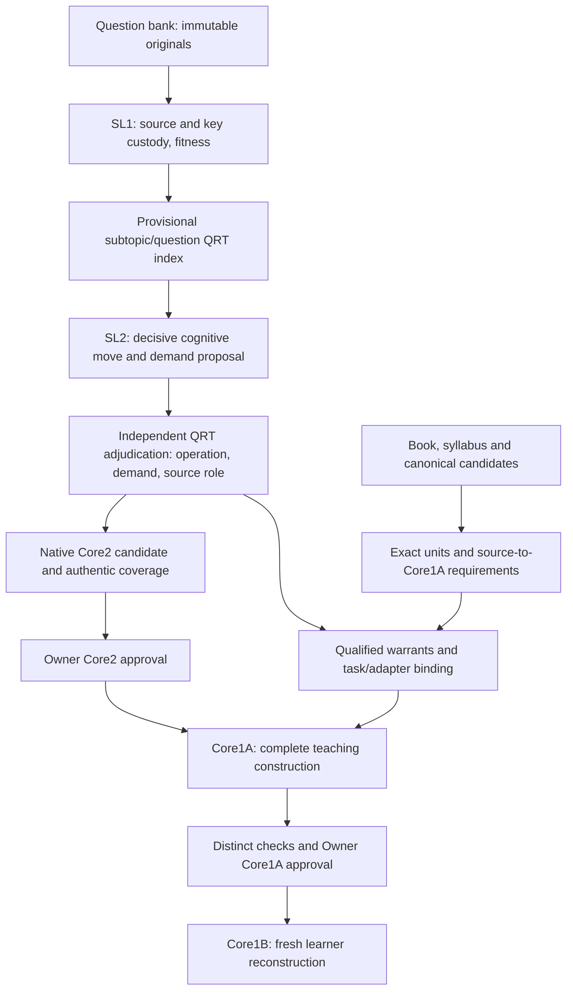

# WPE concept, architecture and decisions

## Aim and immediate outcome

The larger project is a personal learning app, not a corporate product. Existing native Owner intent refines the learner to Grade 10 and target to JEE Main; older Page prose still says Grade 9. Project naming does not overrule that recorded refinement. Physics WPE is the present topic. Default depth is D3/D4; learner assessment is optional.

The latest scoped Owner target is **21 distinct authentic examination originals: three per operation across D3/D4**, followed by approval of Core2, then Core1A, then approval, then Core1B. Seven operations times two bands produces 14 matrix navigation cells; it does not mean 42 required questions. Empty cells and slots remain visible. RETRIEVE, EXPLAIN, APPLY, MODEL, REPRESENT, SYNTHESIZE and JUSTIFY retain their intellectual meanings. Do not rewrite task verbs or inflate demand to fill a quota.

## Two source tracks and ownership

SL1 identifies question/source/figures/key and optional first-try suitability. It does not score examination demand solely from prestige. Source authenticity and official-key authenticity are separate claims. Preserve question, answer/key and dependency identities separately; a changed key must invalidate affected answer/review states even if the stem is unchanged.

SL2 identifies the decisive learner-owned move, inputs/outputs, prerequisites and competing operation classifications, and proposes demand from evidence. QRT independently resolves operation, band and source relationship before placement. An APPLY question can motivate JUSTIFY teaching without becoming JUSTIFY examination evidence. SL2 does not own the Physics proof or certify completed teaching. No Smart Labelling 3 is needed.

The non-bank companion skill interprets exact saved book/syllabus units into candidate construction requirements. Canonical science remains independently qualified. The binder connects reviewed intellectual requirements to actual teaching/reconstruction passages and figures. Shared Physics Blueprint owns general architecture; a minimal topic adapter owns topic bindings, not a second textbook or duplicated Blueprint.

## Current outputs and limits

The first private Core2 deliverable is an **Owner evidence catalogue**, not the native learner Core2 experience. Its search/filter/question-card/matrix UI does not implement typed commitment, genuine saved first attempt, progressive support, structured solution/crux stages or governed native page slots. Earlier scope explains the output; its name does not establish template fidelity. Preserve this useful administrative interface. A future separate native bank/package/manifest and governed renderer pass must implement and exercise the actual Core2 contract.

Frozen original catalogue: 13 conditional leads, eight vacant places, zero admissions. Newer received coverage return: 14 conditional leads, seven vacancies, zero admissions. It contains 79 dispositions but 78 recomputed canonical counting identities; one alias pair counts once. The received diagnostic is explicitly UNAPPOINTED. Its recorded 7 PASS/8 HOLD are diagnostic claims, not independent acceptance. No original frozen package was rewritten to hide this lineage.

Source-to-Core1A R1 is one preparation dossier: six selected sources, 11 exact units, three interpreted claims, three construction-role requirements and seven native field targets. It is an uninstalled companion skill/protocol candidate. There is **no new native Core1A lesson or course package**. Mechanical tests pass while coherent false Physics can also pass: semantics remain NOT_RUN and authoring HOLD.

## Scientific and cognitive truth

Current learner vocabulary v1.1.0 scores five factors 0–2: concept/model selection, representation translation, reasoning chain length, algebra/computational load, trap/exception sensitivity. Sums: D1 0–2, D2 3–5, D3 6–7, D4 8–10. Score only supported intellectual work, avoiding double-counted difficulty, length, exam reputation or answer exposure. Preserve rival classifications and evidence; a score sum is not a semantic verdict.

The WPE library v0.2.0 is CANDIDATE and exists at its original path and local audit copy. Exact-byte availability corrects the old “missing canonical” warning; it does not qualify every warrant. Work-direction currently lacks a bound representation/worked anchor. Blanket friction-work claims need body/frame/contact conditions. Central-force conservativeness needs the actual force law/domain, not merely the word central. System, point of application, observer, zero and dynamic/quasistatic assumptions are load-bearing.

M101 and cut-spring MAIN are separate tasks and must never share identity. Missing original graphs, official-key custody, source wording ambiguities and disputed system/power interpretations remain affected HOLDs. Their private case ledger contains exact source references; this public packet contains no exam stems, answers or protected figures.

## Qualification boundaries

Fail closed at the affected promotion boundary. Unauthenticated exam custody blocks authenticated examination coverage while honest source analysis can continue. Missing optional P1 never blocks learning. QUESTION mode needs no P1. EVIDENCE mode requires the actual earliest saved independent attempt, original reasoning/answer/confidence, exposure/help history and unique identity. Unknown help remains UNKNOWN; a UI commit alone is not durable truthful P1 evidence.

Source hashes establish retained bytes, not official authenticity. External expected source pins detect coherent replacement with refreshed self-hashes; self-declared pins do not. REVIEWED/VERIFIED enums require matching independent authority/dependency evidence. A correct schema, meaningful prose length, file name or green test cannot supply scientific truth.

Native Core1A targets include entry assumptions, inferential jump, teaching path and step action/why-valid/inputs/output, relation conditions/checks, representation correspondence/scenes, construction references and exit task. Native Core1A↔Core2 navigation uses shared capability references. Field existence and matching IDs are insufficient; actual records, package/manifest/assets, renderer and content preservation must be checked. Source-interpretation acquisition and authoring request/packet must be real, never fabricated to satisfy schema.

## Core1A ↔ Core1B witness

Check in both directions: correct target; operation signature; sufficient teaching of every essential warrant and inverse move; fresh learner-owned reconstruction; protected work and state; diagnostic/transfer meaning; Physics and provenance. Use actual passages and scene correspondence, not only shared identifiers. Core1A may fully teach its own construction. It must not pre-expose a protected later assessment route. Original source givens and necessary diagrams are not leaks; added answer overlays and hidden live answers are.

## Next connected outcomes

1. Qualified Core2 evidence/coverage and native interface decision: actual source/figure/key custody, independent cognitive disposition, selected adapter/resolver, explicit vacancies, then Owner review. No fixed completion number may be manufactured from available leads.
2. In parallel, extend non-bank exact-unit/claim preparation and qualify one source-bound construction brief. Resolve canonical warrants and real reviewed task join before lesson construction. Owner Core2 approval is still required.
3. After that approval and a named author assignment, produce one governed Core1A candidate, compare native data and rendered teaching against references, obtain distinct scientific/runtime review and Owner approval. Core1B follows only afterward.

No new agents are created or dispatched by this document. No D3.1 work resumes. Mechanical validation, scientific review, native runtime fidelity and Owner/learner acceptance remain separate.
