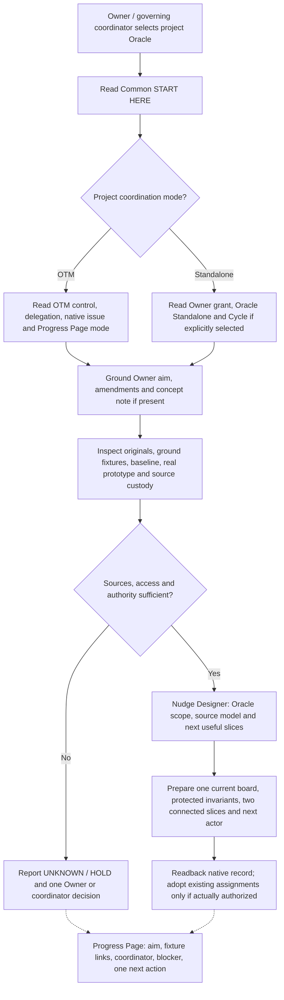
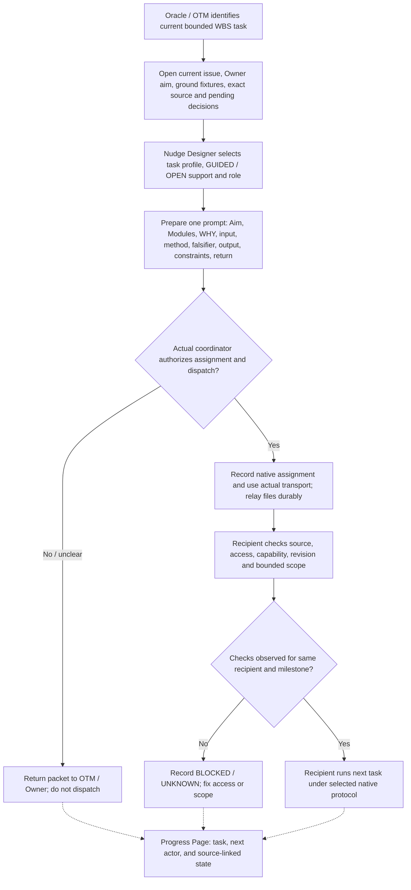
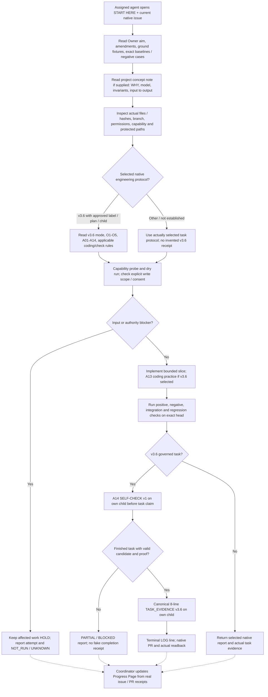
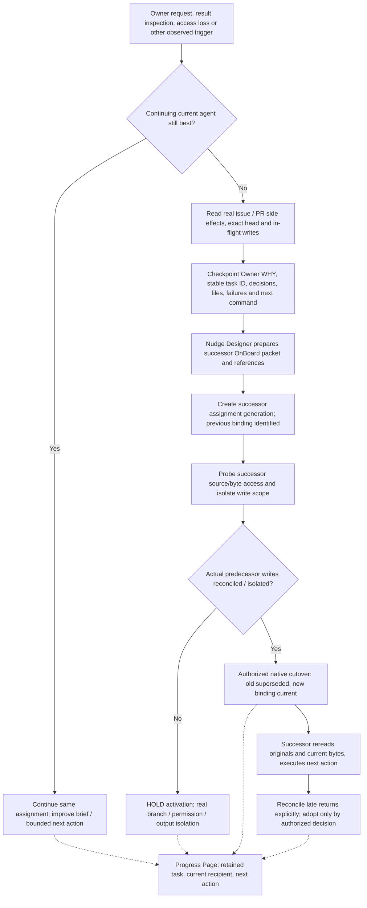
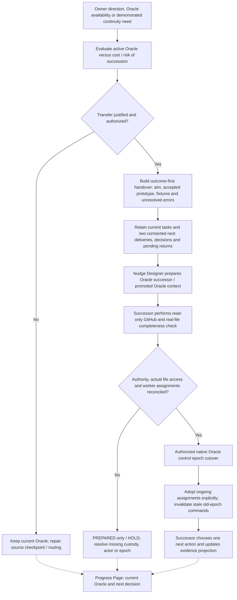

# Five entry process maps — Oracle and agent lifecycle

**Reference model, not a dispatcher or new operating protocol.** Begin at [START_HERE.md](START_HERE.md). Each map shows the normative source boundary, Nudge Designer support and the Progress Page projection. Follow the actually selected OTM/standalone team coordination and any independently selected engineering delivery protocol. Do not turn these diagrams into an extra review or execution gate.

## One shared spine

Owner aim + original ground sources / fixtures / project concept note (if one exists) → bounded assigned task → runnable result + exact source evidence → review/challenge appropriate to risk → integration + Owner decision → Progress Page observation → successor continuation.

- **Common** supplies reusable role/mode/protocol instructions.
- **Native GitHub project** supplies current intent, issues, code/PR heads, permissions and actual receipts.
- **Nudge Designer** prepares a grounded brief or successor prompt; it does not authorize, dispatch, merge or accept.
- **Engineering PR Delivery v3.6** applies only when separately selected with an approved work label and matching plan; its `coordinator/standalone` mode is distinct from the page's `otm/standalone` coordination mode.
- **Progress Page** reads recorded native evidence through its coordinator; it does not make current GitHub states true by display. Only a project with a live onboarding group shows the PR #14 readiness panel.
- **Artifact relay** is necessary for file/workpack exchange even when a chat has a `sandbox:` path; verify recipient-byte access separately and keep protected/private bytes private.

## A. Oracle onboarding — initial project setup

**Inputs:** Owner words and amendments, canonical project issue/PR, repo instructions, concept note/architecture rationale if actually present, ground-fixture hashes and current real-file custody, stage and review/merge limits.

**Nudge Designer:** [Oracle execution guidance](nudge-designer/references/ORACLE_EXECUTION.md), [Oracle OnBoard guidance](nudge-designer/references/ORACLE_ONBOARD.md), [Oracle prompt](nudge-designer/assets/prompts/oracle.md), [core/coding/UI/logic profiles as needed](nudge-designer/references/PROFILES.md). If a builder is legitimately promoted after demonstrated project understanding, use the [promoted Oracle section](nudge-designer/assets/prompts/oracle-onboard.md#promoted-oracle); promotion is not an automatic grant.

**Progress Page:** project aim, revision/source refs, ground-fixture inventory, current actual coordinator/Oracle and one next WBS slice. Its role/recorder mode is [OTM vs standalone](progress-page/references/MODES.md). A source link or readiness stage alone does not activate Oracle control. In OTM projects the Oracle routes findings through OTM, not a self-assigned standalone Cycle.

## B. Oracle onboards a builder / reviewer / specialist agent

**Nudge Designer:** [Oracle OnBoard prompt template](nudge-designer/assets/prompts/oracle-onboard.md), [assignment](nudge-designer/assets/prompts/assignment.md), [worker](nudge-designer/assets/prompts/worker.md), [reviewer](nudge-designer/assets/prompts/reviewer.md), and [adaptive support](nudge-designer/references/ADAPTIVE_SUPPORT.md). Choose just the relevant recipient template and profile; do not concatenate every instruction or expose golden answers to a fresh reviewer.

**Progress Page:** one assigned task + current actor, actual source links and next action; on projects with a designated onboarding group it projects the four observed stages: **Not assigned → Sources checked → Access verified → Ready for bounded task**. Stage records must match the current recipient and milestone, use actual GitHub evidence and form a complete ordered chain. These stages never confer authority, file access, independent review or engineering PASS.

## C. Agent first execution — ground sources, concept note, coding and v3.6 proof

**Concept note is project-specific grounding, not a required new v3.6 file.** Read it if supplied, checking whether its architecture/model claims still match Owner intent and original sources. Explain **input → responsible function/decision → consumer/output**, accepted/preserved behavior and a discriminating wrong case. Do not treat an author's concept note as a substitute for an original requirement.

**Exact v3.6 rules:** an actual [approved AIM label and matching plan](../engineering-pr-delivery-v3.6/SKILL.md#1-mandatory-inputs--work-specific-never-silently-default), real owned child issue and separately authorized writable scope. v3.6 O1 decomposes; O2 collects own-child evidence; O3/O4 project titles; O5 supports cold continuation. Agent must inspect [A01–A14 coding/issue addendum](../engineering-pr-delivery-v3.6/CODING_PRACTICES_ADDENDUM.md#agent-requirements-a01a14-409-4-plus-the-owners-a13a14) and the selected [coordinator](../engineering-pr-delivery-v3.6/MODE_COORDINATOR.md) or [standalone](../engineering-pr-delivery-v3.6/MODE_STANDALONE.md) delivery mode. A13 includes the scope-bound 300-line authored-file ratchet and regression checks.

**A14 before claim:** post source-bound **SELF-CHECK v1** companion first. When a finished task truly qualifies, publish the exact **eight-line** canonical [TASK_EVIDENCE v3.6](../engineering-pr-delivery-v3.6/SKILL.md#3-task_evidence--exact-opening-and-independent-proof) on the **same actual child issue**. The `For the user:` line carries the self-check permalink; `Proof:` remains an appropriate PR/commit proof, **not** the self-check comment. End the execution/handover response with the native [one terminal LOG line](../engineering-pr-delivery-v3.6/SKILL.md#4-agent-log-line--mandatory-terminal-footer). Blocked work without real evidence gets an honest status/context return, never fabricated `TASK_EVIDENCE` or E-credit. Task evidence is not independent approval or Owner acceptance.

**Nudge Designer:** the agent receives [one grounded Oracle OnBoard packet](nudge-designer/assets/prompts/oracle-onboard.md) and only applicable [coding profile / understanding / falsifier guidance](nudge-designer/references/PROFILES.md). Nudge Designer does not replace v3.6's own evidence parser, A14, issue chain, review or LOG.

**Progress Page:** the agent does **not** directly edit page JSON. The actual coordinator reads its native child issue, PR head, checks, blockers and next-step receipt and updates the existing card, fixture links and audit Timeline using the [page CLI/mode route](progress-page/references/MODES.md). Do not infer VERIFIED from the author's declared DONE.

## D. Agent continuity — when and how the Oracle changes executor

**Replacement triggers (not automatic handoffs):** Owner preference; repeated material blocker after correcting input/method; genuinely absent capability; context no longer supporting the source/model; a justified new specialization or a final prototype boundary. Continue the same agent when it is producing good evidence and a swap adds more risk than value. In the selected ChatGPT-agent activity scope only, **more than five distinct GitHub-access turns or over 35 recorded active-turn minutes** triggers a **BuddyRunner suggestion**, not retirement, acceptance or automatic replacement.

**Successor prompt:** [Oracle OnBoard template](nudge-designer/assets/prompts/oracle-onboard.md) must retain **same stable task ID**, new assignment/session generation, old assignment reference, exact baseline/head, Owner amendments, carried decisions, last actual tests, in-flight/late returns, private file access route and **one next bounded action**. Use [successor prompt reference](nudge-designer/assets/prompts/successor.md) when suited. Completed BuddyRunner / two-pass / three-pass stages are reused, never restarted as an onboarding exam.

**Progress Page:** preserve the original task/history; show replacement recipient, held/pending/active work, exact evidence and source-backed changeover Timeline. The PR #14 onboarding view fails closed for the **new** recipient: predecessor readiness evidence does not promote it. Page updates are **not** the secure cutover or physical removal of old write permission.

## E. Oracle continuity — when and how whole-project coordination moves

**Oracle succession triggers:** explicit Owner/OTM decision; current Oracle lost/unavailable; consequential source-model or decision-continuity failure; repeated coordination mistakes or unreconciled control; proposed promotion after demonstrated cross-task understanding; or other documented benefit greater than handover cost. **Not** an automatic event because a chat is long, a task finishes or a new chat ID appears.

**Seven-section source packet:** use the [outcome-first Oracle handover protocol](oracle-standalone/references/ORACLE_HANDOVER_PROTOCOL.md): actual landing/fixture pointers, Owner aim and acceptance, exact working prototype versus next outcome, material findings, five ranked useful actions with one next actor, private file completeness/custody and control/authority state. The successor starts **read-only** and must rederive the current candidate, pending contradiction and executable next action from canonical sources. In OTM mode the selected TeamCoordinator/OTM authority controls nomination and cutover, not the standalone Oracle skill.

**Nudge Designer:** use [Oracle OnBoard: promoted Oracle](nudge-designer/assets/prompts/oracle-onboard.md#promoted-oracle), [oracle prompt](nudge-designer/assets/prompts/oracle.md), [successor prompt](nudge-designer/assets/prompts/successor.md) and source-oriented [Oracle execution](nudge-designer/references/ORACLE_EXECUTION.md). Guidance is revisable, not permission. Preserve previous agent assignments without re-onboarding them automatically.

**Progress Page:** keep the **same project/WBS/history**. After genuinely authorized control transfer, update coordinator/Oracle identity, continuity checkpoint, unresolved items, next two slices, evidence and Timeline. [`project transfer`](progress-page/references/MODES.md#moving-a-project-between-modes) is for an actual recorded change of coordinator/mode, **not** a substitute for native epoch cutover and not necessary for every Oracle chat replacement. The page cannot authenticate a principal or reject stale epoch commands.

## How the page links to all five steps

| Entry | What the participant **reads** from the page | What the coordinator **records after source verification** | What it cannot assert |
| --- | --- | --- | --- |
| A — initial Oracle | Owner aim, revision, original fixture and roadmap refs, present task, coordinator | Oracle task/recipient, source gaps, current milestone and next actor | Authenticated Oracle control or verified private-byte access |
| B — agent onboarding | One WBS task, current role/actor, source/return links, four readiness stages | Recipient-and-milestone-bound source/access/ready receipts via existing fixtures/audit | Dispatch, authority, engineering PASS or independent identity |
| C — agent execution | Aim, protected scope, actual task and input references | Native issue/PR SHA, claim evidence, user trial, NOT_RUN, known defects and next action | Acceptance from code/test totals, self-check or title alone |
| D — agent continuity | Stable task, current candidate, old/new binding, blockers, last result | New actor plus new readiness observations, replacement receipt and pending/late returns | Atomic reassignment, write revocation, inherited readiness |
| E — Oracle continuity | Project summary, prototypes/fixtures, current actor, next two slices | Owner/coordinator control decision, successor checkpoint, pending assignments, source-linked Timeline | Activated epoch, authenticated author, inferred new merge rights |

For all modes, **agents leave evidence in native GitHub issues/PRs**; only the governing page coordinator projects it. Progress Page Nudge+ sends an **instruction to the coordinator**, not directly to an agent: the coordinator interprets it under the real authority protocol, sends through actual transport, then records the source of the send.

## Which references and examples to open

| Entry | Essential Nudge Designer support | Example or raw/golden distinction |
| --- | --- | --- |
| A | [Oracle execution](nudge-designer/references/ORACLE_EXECUTION.md), [core profile](nudge-designer/references/PROFILES.md), [Oracle prompt](nudge-designer/assets/prompts/oracle.md) | [Oracle execution application](nudge-designer/examples/oracle-execution/ASSESSMENT.md); prior source checks are historical |
| B | [Oracle OnBoard](nudge-designer/references/ORACLE_ONBOARD.md), [GUIDED/OPEN support](nudge-designer/references/ADAPTIVE_SUPPORT.md), [worker/reviewer templates](nudge-designer/assets/prompts/) | [Team cycle example](nudge-designer/examples/team-cycle/ASSESSMENT.md); use source case before expected return |
| C | [coding + logic profiles](nudge-designer/references/PROFILES.md), [verification](nudge-designer/references/VERIFICATION.md) | [Logic application](nudge-designer/examples/logic/ASSESSMENT.md) plus v3.6's own test/format templates |
| D | [Oracle OnBoard](nudge-designer/assets/prompts/oracle-onboard.md), [successor template](nudge-designer/assets/prompts/successor.md) | [Isolated-forward test](nudge-designer/examples/isolated-forward/ASSESSMENT.md); keep evaluation references separate from new worker |
| E | [Promoted Oracle](nudge-designer/assets/prompts/oracle-onboard.md#promoted-oracle), [Oracle execution](nudge-designer/references/ORACLE_EXECUTION.md) | [Oracle continuity state examples](oracle-continuity/examples/initial.json) and [worked CIIFR handover](oracle-standalone/examples/CIIFR_R3_HANDOVER.md) |

**Examples are instructional**, not a reusable current project claim. Fresh independent trials start from authorized raw inputs and current original sources; the golden/expected answers may be used afterward for assessment, with exposure disclosed.

## Minimal routing rule for a new chat

Send only **(1)** Common START HERE, **(2)** the actual task or project-source URL and its governing mode/role, and **(3)** the current exact source/byte-access locator when needed. The receiving participant uses this map for selective references and returns native evidence. Do not paste an entire historical programme, restart completed multipass workflows, or invent new issue IDs, permission or a second progress database.

