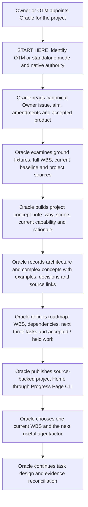
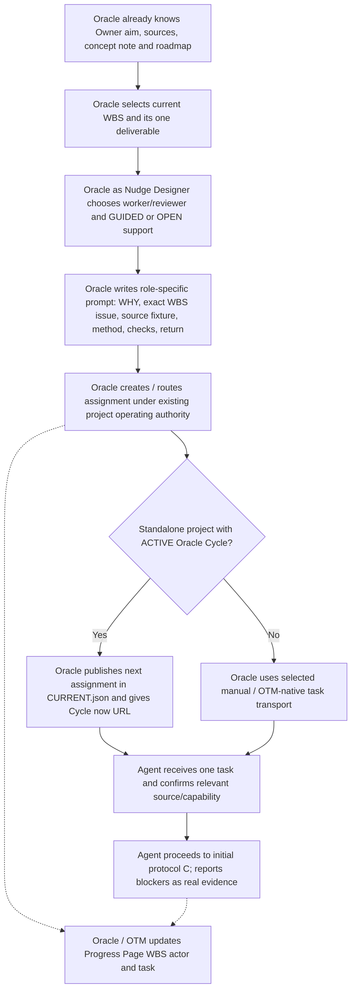
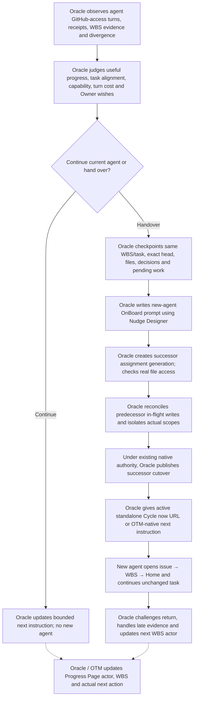
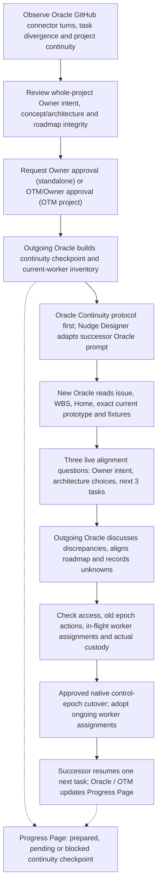

# Five entry process maps — Oracle-owned execution and continuity

**Operating design:** Common [START HERE](START_HERE.md) is the entry router; the Oracle owns the project working model and prepares Nudge Designer briefs (in OTM mode, within OTM dispatch/control; in standalone, under Owner selection). The agent reads its assigned **issue → WBS → project** sources, then executes its selected engineering protocol. The Progress Page Home displays the project concept, architecture explanations, source fixtures and roadmap; WBS cards show delivery and evidence. The Page is a projection, never a new control authority.

## One shared spine

Owner intent and issue-based project grounding → Oracle project Home (concept note, architecture/complex concepts, original fixtures and roadmap) → Oracle-assigned WBS slice → agent `Cycle now` bootstrap in an **activated standalone Cycle** or actual OTM/native dispatch → v3.6 coding and own-child evidence → Oracle challenge and Progress Page update → agent / Oracle continuity when warranted → Owner acceptance.

- **Cycle now:** the [GitHub Oracle Cycle protocol](../../oracle-cycles/PROTOCOL.md) is the one-line **standalone** execution transport *when that project has activated an Oracle Cycle*: `Cycle now: https://github.com/reallakshman19/Common/tree/main/oracle-cycles/<project>` for a cold chat; `Cycle now` for a chat with a verified locator and role. The receiver must read actual `CURRENT.json` on canonical `main`, confirm `mode=standalone`, `activation=ACTIVE`, its role, generation and assigned task, and return a public-safe `ORACLE-CYCLE-RECEIPT v1` to its designated GitHub issue, with readback. No assignment → `NO ACTION`; inactive → `NOT ACTIVE`. Do not confuse a cycle receipt with v3.6's separate native `TASK_EVIDENCE`.
- **Progress Page ownership:** OTM updates the page in OTM projects; **the project Oracle updates it in standalone** using the existing page CLI/Timeline and Owner-reviewed DRAFT PR. Agents post evidence to native issues/PRs, not to page JSON. Oracle ensures Home is up to date as Owner intent, architecture or roadmap changes.
- **Concept note, architecture and complex concepts:** publish Oracle-authored **source-bound explanations or public-safe links** in the existing grounding fixtures. Keep Owner-approved concepts distinct from hypotheses and recorded alternatives. Protected file bytes remain in authorized custody; Home links/notes do not expose them.
- **Grounding and evidence:** v3.6 applies when selected for this engineering work with approved AIM label, plan, actual child issue and write authority. Its `coordinator/standalone` delivery mode remains separate from Progress Page's `otm/standalone` mode. There is no extra v3.6 permission check invented by the process map.
- **Continuity:** Oracle may recommend agent change from observable GitHub-access turns, task/WBS divergence, material stagnation, capability or Owner preference. The >5 distinct GitHub turns / >35 active minutes rule is only a BuddyRunner *suggestion* when its documented ChatGPT agent scope applies, never forced handoff.
- **Review and acceptance:** Oracle challenges actual evidence; a self-authored contribution remains SELF_ASSESSED. OTM/Owner grant and selected native epoch/custody restrictions remain operative; no UI, prompt or role label silently authorizes a PR merge or releases private data.

## A. Oracle onboarding — initial project setup

**Project Home is the project knowledge base, not just a blocker strip.** Oracle maintains **Owner intent and amendments, concept note, purpose, architecture/complex models and their rationale, diagrams or explanatory links, original ground fixtures with exact identity/custody, roadmap/WBS dependency structure, current working prototype, decisions, open contradictions, current actors and next deliverable**. Home displays information supported by the existing project records. Where a concept note is not yet recorded, it says so; the Oracle supplies the missing source-grounded note, rather than the viewer inventing it. The detailed issue and WBS are still canonical for task execution.

**Nudge Designer = Oracle's design tool**, not a separate participant. Use [Oracle execution](nudge-designer/references/ORACLE_EXECUTION.md), [conceptual blueprint](nudge-designer/references/BLUEPRINT.md) and the selected [profiles](nudge-designer/references/PROFILES.md) to author and revise this model. In OTM projects, Oracle sends its task/control recommendations through the actual OTM route; in standalone it coordinates directly as selected.

**Progress Page:** Oracle owns Home content and source quality; the actual **page writer** is OTM in OTM mode and Oracle in standalone. The project view should prominently show concept note, architecture/complex concepts and full roadmap, with grounded original fixtures—not only sources, blockers and a next-action sentence.

## B. Oracle onboards a builder / reviewer / specialist agent

Oracle must **not re-read its own complete project grounding at each assignment**. It uses the current grounded Home/roadmap and selected WBS issue to prepare the briefing. A material Owner amendment, changed source or stale evidence warrants targeted re-grounding, not a ritual repeat.

**Nudge Designer is performed by the Oracle**: [Oracle OnBoard](nudge-designer/assets/prompts/oracle-onboard.md), [worker](nudge-designer/assets/prompts/worker.md), [reviewer](nudge-designer/assets/prompts/reviewer.md), and [adaptive support](nudge-designer/references/ADAPTIVE_SUPPORT.md) supply reusable prompt formats, not a second approval actor. Every prompt keeps an `Aim:` and `Modules:` line, scope, source references and return contract.

**Progress Page:** **Oracle is accountable for the WBS task/actor updates in standalone**; OTM is the authorized page writer in OTM mode. The four readiness observations in PR #14 remain optional recorded source/access/ready facts for the same actor/WBS, **not a decision gate** and not a question that blocks routine dispatch. The selected team/native scope and any existing engineering HOLD still govern real writes.

## C. Agent initial protocol — issue → WBS → project → v3.6 delivery

This process map is specifically for **engineering work selected under v3.6**. If a project has not selected v3.6, use its actual native delivery protocol rather than fabricating an AIM label or task receipt.

```mermaid
flowchart TD
  C0["Agent starts: Cycle now URL if active standalone Cycle, otherwise received native task"]
  C0 --> C1["Open CURRENT.json if Cycle; resolve exact assignment and issue"]
  C1 --> C2["Issue → WBS: task scope, Owner amendments, criterion and existing evidence"]
  C2 --> C3["WBS → Project Home: Owner intent, concept note, architecture, full roadmap"]
  C3 --> C4["Read ground fixtures, original files, negative cases and protected invariants"]
  C4 --> C5["Load v3.6 approved AIM label, plan, child issue and selected delivery mode"]
  C5 --> C6["Use A01-A14, A13 coding standards; dry-run and actual allowed scope"]
  C6 --> C7["Build assigned slice and test positive / negative / regression on exact head"]
  C7 --> C8["A14 SELF-CHECK v1 on own child before the completion claim"]
  C8 --> C9["Publish canonical 8-line TASK_EVIDENCE on own child for finished task"]
  C9 --> C10["Terminal LOG and linked PR/head; reconcile pending items"]
  C10 --> C11["If standalone Cycle: post ORACLE-CYCLE-RECEIPT and read back permalink"]
  C11 --> C12["Oracle reviews issue evidence, challenges return and selects next task"]
  C12 -.-> CP["Oracle updates Progress Page: WBS evidence, blocker, next actor; project Home if changed"]
```

**Issue first, then WBS, then project**: the agent starts from the actual assigned issue (including Owner amendments and source evidence), identifies its WBS position and dependencies, then opens the larger project Home and only the relevant ground fixtures and concept/architecture materials. A concept note is grounding, not a substitute for native criteria.

**Always v3.6 in this mapped engineering execution:** [SKILL](../engineering-pr-delivery-v3.6/SKILL.md), appropriate [coordinator](../engineering-pr-delivery-v3.6/MODE_COORDINATOR.md) / [standalone](../engineering-pr-delivery-v3.6/MODE_STANDALONE.md) delivery instructions and [A01–A14 addendum](../engineering-pr-delivery-v3.6/CODING_PRACTICES_ADDENDUM.md). The approved AIM label/plan, actual own-child issue, scope/permissions and dry-run are still native prerequisites; this process does not need a duplicate `Can execute?` decision box.

**Exact v3.6 evidence:** A14 SELF-CHECK v1 is published first on the own-child issue. For a task with valid finished-task proof, publish the unmodified eight-line `TASK_EVIDENCE v3.6`; its `For the user:` line carries the self-check permalink and `Proof:` remains a qualifying PR/commit URL. The response ends with one native terminal LOG. If work is blocked/partial or tests not run, report honestly rather than inventing a finished-task receipt. **Cycle receipt and TASK_EVIDENCE are distinct**; Oracle reconciles both.

**Nudge Designer:** Oracle authored the task and source-specific method; the agent is not asked to act as a second Nudge Designer. Use the relevant [coding/logic profile](nudge-designer/references/PROFILES.md) only to interpret the bounded task. Oracle later revises the prompt when actual evidence contradicts it.

**Progress Page:** Oracle (or OTM in OTM projects) reads the native issue/PR/test evidence, publishes WBS truth and updates Home only if the actual project concept, architecture or roadmap changed. The agent does not edit page JSON or set engineering VERIFIED from its own DONE.

## D. Oracle-driven agent continuity — GitHub turns + WBS judgment

**Trigger judgment belongs to Oracle:** derive from *observed* GitHub-access turns and actual WBS progression or divergence, source-model/context degradation, repeated blocker after corrected instruction, demonstrated unavailable capability, Owner preference and handoff cost. A long conversation or task completion by itself does not compel replacement. Where selected and applicable to an actual ChatGPT agent, **>5 distinct GitHub-access turns or >35 recorded active-turn minutes** triggers a **BuddyRunner suggestion**, not a forced transfer; do not invent hidden usage telemetry.

**All downstream handoff work is led by Oracle**: checkpoint, new assignment generation and `replaces_assignment_id`, [Nudge Designer successor prompt](nudge-designer/assets/prompts/oracle-onboard.md) + [successor template](nudge-designer/assets/prompts/successor.md), source/byte access probe, predecessor in-flight comparison, real branch/output isolation, native cutover and treatment of late returns. For an OTM-governed project Oracle submits/coordinates these through the actual TeamCoordinator/OTM authority rather than claiming it can unilaterally supersede that control. An unchecked declaration in `CURRENT.json` is not real write revocation.

**Progress Page:** Oracle makes the grounded WBS/actor/progress update in standalone; OTM writes it in OTM projects. The same WBS/task survives, new-agent readiness observations are recipient-specific, and historical evidence stays scoped to its old head.

## E. Oracle continuity — turn/divergence triggers and three-question alignment

**Handoff triggers:** the Oracle's observed GitHub-access turn burden together with **divergence from the Owner intent, current task or roadmap**, reduced source-model integrity, inability to reconcile WBS/evidence, unavailable Oracle or explicit Owner direction. The trigger is a **recommendation for Owner or governing OTM approval**, not automatic changeover or a universally defined turn count. The separate ChatGPT agent activity rule can suggest BuddyRunner, but it does **not** itself retire an Oracle.

**Protocol sequence:** [Oracle Continuity](oracle-continuity/PROTOCOL.md) and [outcome-first handover](oracle-standalone/references/ORACLE_HANDOVER_PROTOCOL.md) are the primary sources. Oracle uses Nudge Designer **after** identifying the actual control epoch, project checkpoint and pending assignments, to prepare a concise [promoted/successor Oracle prompt](nudge-designer/assets/prompts/oracle-onboard.md#promoted-oracle). Only the actual Owner/OTM and native publisher activate the new epoch; open worker assignments are expressly adopted, not abandoned.

**Three conversational questions (not a scored exam or statistics):**

1. **Owner intent and user outcome:** "What exactly is the Owner trying to achieve, what demonstrably works now, and which acceptance limits must not be crossed?"
2. **Complex architecture/concept:** "Which current source-model or architectural decisions are essential, where are they recorded, and which important alternative or unresolved contradiction could change the plan?"
3. **Roadmap and immediate continuation:** "What are the **next three sensible tasks**, in which dependency order, which participant acts on the first, and what concrete user-visible result or evidence should follow?"

The outgoing Oracle compares the answers with actual issue/WBS/Home/fixtures and **helps align any misunderstanding**. These are a useful guided alignment conversation, not the v3.6 prohibited Q1–Q5 takeover exam, a score, a proof of actor identity, or an extra engineering PASS. When a source is missing, record UNKNOWN; alignment cannot replace real access or native transfer authority.

**Progress Page:** retain the whole Home and historical WBS; record approved Oracle identity, current coordinator, outcome-first checkpoint, next three tasks, known open agent assignments, hold/activation state and timeline. In OTM mode the project page writer remains OTM unless a real mode transfer is separately authorized. A page update never revokes a predecessor's write access by itself.

## Progress Page: project Home plus WBS/issue evidence

**Home:** Oracle keeps all source-grounded **Owner intent, effective amendments, project concept note, architecture and complex concept explanations, original source/fixture inventory and custody, roadmap/WBS relationships, current accepted/runnable product, major decisions, unresolved contradictions and next three tasks**. Use the page's existing project + grounding-fixture records, not a second task database. The Progress Page viewer may show "not recorded" for a missing conceptual source; Oracle must repair its public-safe source record. Exact sensitive details stay in private custody.

**Issue → WBS → Project:** an agent follows the **issue** (actual assignment/acceptance and Owner amendments) → **WBS** (its milestone/dependencies and evidence) → **project Home** (concept, architecture, fixtures and roadmap). Oracle moves in reverse when planning: **Home → roadmap/WBS → task issue**. This avoids making agents read an entire project at every assignment.

| Entry | Oracle / OTM project updates | Progress Page display |
| --- | --- | --- |
| A — Oracle setup | Oracle authors Home grounding, concept note, architecture/complex concept links and roadmap; OTM records if OTM mode | Home source model + roadmap; current Oracle and next WBS |
| B — agent onboarding | Oracle issues bounded prompt and updates current actor; OTM writes in OTM mode | Assigned issue/WBS, actor, relevant fixtures and optional readiness |
| C — agent execution | Oracle reconciles v3.6 own-child + Cycle receipts; OTM writes in OTM mode | WBS current evidence, exact head, task status, observed defects and next actor |
| D — agent continuity | Oracle preserves stable task and recipient succession, native control bound separately | WBS predecessor/successor evidence, genuine handoff status and new readiness |
| E — Oracle continuity | Oracle continuity packet, Owner/OTM-approved new epoch and worker adoption | Same Home/roadmap, new Oracle after actual cutover, three-task next outlook |

**Cycle now transport vs Progress Page:** the active canonical `oracle-cycles/<project>/CURRENT.json` selects the current assignment, and the Oracle Cycle issue is the return inbox. Neither is replaced by page cards. Progress Page is updated by Oracle/OTM from actual receipts through [mode-specific CLI/Timeline](progress-page/references/MODES.md), and not by an agent's self-reported completion. `Nudge+` is an instruction to the coordinator, who writes the actual agent prompt, not direct dispatch.

## Which references and examples to open

| Entry | Essential Nudge Designer support | Example or raw/golden distinction |
| --- | --- | --- |
| A | [Oracle execution](nudge-designer/references/ORACLE_EXECUTION.md), [core profile](nudge-designer/references/PROFILES.md), [Oracle prompt](nudge-designer/assets/prompts/oracle.md) | [Oracle execution application](nudge-designer/examples/oracle-execution/ASSESSMENT.md); prior source checks are historical |
| B | [Oracle OnBoard](nudge-designer/references/ORACLE_ONBOARD.md), [GUIDED/OPEN support](nudge-designer/references/ADAPTIVE_SUPPORT.md), [worker/reviewer templates](nudge-designer/assets/prompts/) | [Team cycle example](nudge-designer/examples/team-cycle/ASSESSMENT.md); use source case before expected return |
| C | [coding + logic profiles](nudge-designer/references/PROFILES.md), [verification](nudge-designer/references/VERIFICATION.md) | [Logic application](nudge-designer/examples/logic/ASSESSMENT.md) plus v3.6's own test/format templates |
| D | [Oracle OnBoard](nudge-designer/assets/prompts/oracle-onboard.md), [successor template](nudge-designer/assets/prompts/successor.md) | [Isolated-forward test](nudge-designer/examples/isolated-forward/ASSESSMENT.md); keep evaluation references separate from new worker |
| E | [Promoted Oracle](nudge-designer/assets/prompts/oracle-onboard.md#promoted-oracle), [Oracle execution](nudge-designer/references/ORACLE_EXECUTION.md) | [Oracle continuity state examples](oracle-continuity/examples/initial.json) and [worked CIIFR handover](oracle-standalone/examples/CIIFR_R3_HANDOVER.md) |

**Examples are instructional**, not a reusable current project claim. Fresh independent trials start from authorized raw inputs and current original sources; the golden/expected answers may be used afterward for assessment, with exposure disclosed.

## Minimal routing for a new chat

The Oracle sends **Common START HERE + actual task issue/WBS URL**. In an **activated standalone Oracle Cycle**, use the cold-chat `Cycle now: <project URL>` so the agent reads `CURRENT.json` and actual binding on `main`. A registered chat may use plain `Cycle now`. Follow the native issue→WBS→project Home read, relevant ground fixture and exact private-byte custody; submit v3.6 evidence plus distinct Cycle receipt as applicable. In OTM mode use the selected governed transport instead of importing the standalone Cycle.

No new permission, independent review, merge, schema, context exam or second progress database arises from these diagrams.
