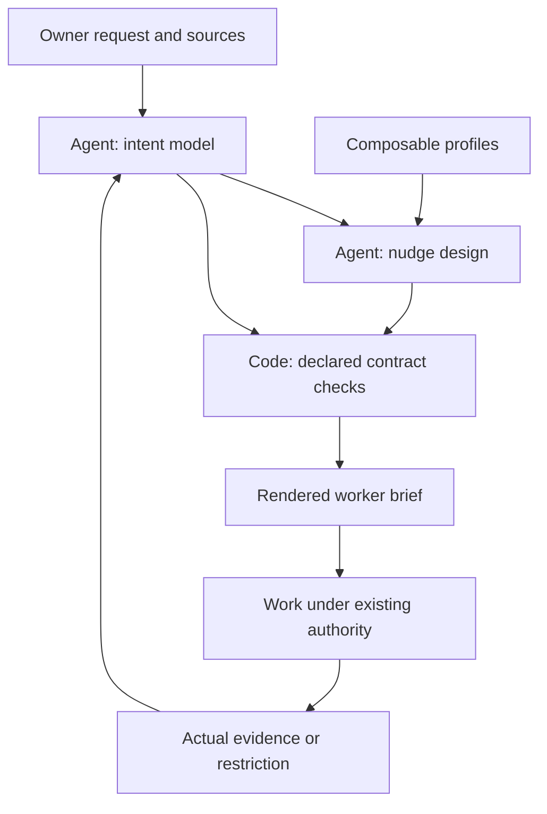

# Nudge Designer v1 blueprint

## Contents

- [Purpose and architecture](#purpose-and-architecture)
- [Inputs and outputs](#inputs-and-outputs)
- [The two contracts](#the-two-contracts)
- [Planning and revision](#planning-and-revision)
- [Limits and evaluation](#limits-and-evaluation)

## Purpose and architecture

Preserve actual intent while turning a difficult problem into useful work. The
core is domain-independent; profiles supply relevant understanding, thinking
operations and evidence methods. A UI is optional. No fixed two-pass or three-pass
process is imposed on every problem.

Agent judgment owns reconstruction, decomposition, hypotheses, evidence choice
and semantic reconciliation. Code owns parsing, declared checks, content binding,
rendering and declared revision impact. No work executor or LLM orchestration
service is installed.

## Inputs and outputs

| Input | Treatment |
|---|---|
| Short Owner request | Retain original wording and purpose; agent does the modeling |
| Sources, amendments and revisions | Cite directly; record assessment and conflicts |
| Prior plans, receipts and failures | Separate reports from fresh observations; retain useful work |
| Task dimensions | Compose profiles, such as UI + logic + quantities + coding |
| Worker configuration and tools | Record observed or supplied basis, with UNKNOWN where necessary |
| Existing scope and protocols | Preserve authorization and independent protocol selection |

| Output | Consumer and meaning |
|---|---|
| `intent.json` | Designer/Owner: reconstruction with conditions and unknowns |
| `plan.json` | Coordinator: draft nudges, outcomes, dependencies and declared coverage |
| Rendered nudge | Worker: seven-element brief, understanding, evidence and continuation |
| Validation report | Author/tooling: structural status, never execution approval |
| Impact report | Designer: candidate affected work; no mutations or dispatch |
| Owner reconciliation | Human: direction, evidence limits, reserved decisions and next work |

No claim is made that all risks or original sources have been discovered. A
missing input may require reconstruction or a targeted question. It need not stop
independent work. Do not ask the Owner to operate the internal schemas.

## The two contracts

The schemas are the exact field/type authority. IDs are stable references;
revisions are positive integers. Unknown text can be `null` only where permitted.
Empty strings are not unknown markers.

### Intent: `nudge-designer.intent/v1`

| Group | Meaning |
|---|---|
| Identity, revision, request, purpose | Model identity and retained human outcome |
| `sources` | Locator/revision, OWNER/SOURCE/RECEIPT/SYNTHETIC/UNKNOWN, inspection assessment |
| `items` | REQUIREMENT/CONSTRAINT/FACT/HYPOTHESIS/PROPOSAL/UNKNOWN, exact condition, state, references |
| `outcomes` | Observable completion, parent hierarchy and item references |
| `knowledge` | What must be understood and why, with source/outcome scope |
| `worker` | Model/effort basis, reported tools and reserved decisions |
| `scope` | Supplied permitted/forbidden changes, cited basis and caveats |
| `protocols` | Independently selected thinking and delivery protocols, or null |

Substantive items need sources. UNKNOWN can be uncited but stays unresolved or
superseded. A proposal stays proposed or superseded. Cited IDs must exist;
outcome ancestry must be acyclic. OWNER classification does not prove the speaker's
identity or current authorization.

A constraint with empty `outcome_refs` applies globally; an outcome-scoped
constraint applies to that outcome and descendants. Relevant constraints must
appear in `boundaries.preserve_refs`. Conditions are rendered verbatim as quoted
data. Wording in the wrong place still needs semantic review.

### Plan: `nudge-designer.plan/v1`

| Group | Meaning |
|---|---|
| Identity and bindings | Intent ID/revision/digest and selected profile contents digest |
| `strategy` | Agent's reasoned direction, including reuse or uncertainty |
| `nudges` | Seven elements, understanding, operations/evidence and scoped references |
| `parent_id`, `depends_on`, `branches` | Decomposition, advisory prerequisites, conditional next candidates |
| `coverage` | Every declared requirement/constraint/unknown and outcome has a disposition |
| `handover` | Remaining work, changed understanding and next eligible action |

Coverage dispositions: PLANNED, EVIDENCE_REPORTED, UNRESOLVED, DEFERRED and
SUPERSEDED. PLANNED requires a nudge. EVIDENCE_REPORTED requires a source, and does
not mean accepted, independently reviewed or executed here. UNRESOLVED and DEFERRED
are useful information, not automatically a failed plan.

Bindings use SHA-256 over UTF-8 JSON with sorted keys, compact separators,
`ensure_ascii=False`, `allow_nan=False`. Profile binding covers selected objects
sorted by ID. These implementation-specific canonical digests detect stale
content; they are not source authentication or standard signatures.

## Planning and revision

Decompose coherently: project purpose → outcomes → owned problems → nudges.
An investigation can deliver a decisive observation without implementing every
repair. Correct content can leave learning evidence unresolved. A numerical
reference can verify a calculation without validating the physical idealization.

Design a meaningful contrast: what observation would disprove the current
explanation? Choose evidence that can answer it. More passes, longer responses
or more checks cannot substitute for that decision.

Retain useful prior work when its basis survives. Explain changes with evidence
or an identified gap, not a compulsory improvement quota. Do not disguise an
architecture/model/authority decision as a tiny implementation assignment.
Reserve that judgment with a useful return condition.

For consequential direction choices, compare plausible alternatives using the
expected outcome gain, evidence strength, effort and uncertainty. Record why the
chosen next work has high value; do not fabricate numeric ROI. A discriminating
probe, an evidenced KEEP or a targeted improvement can each be the right choice.

For revisions, compare the previous intent and bound plan with the current
intent. The impact tool checks changed declared rows and global context, relevant
constraints/knowledge, dependency descendants and nudge ancestry. An unchanged ID
is not unchanged meaning. An unchanged digest is not source truth.

Impact identifies candidate review work. It does not rewrite a plan, freeze work,
cancel external tasks or modify sent instructions. Preserve history, review
undeclared dependencies and issue visible corrections where needed.

## Limits and evaluation

Machine checks reject malformed JSON, duplicates, broken references, cycles,
stale bindings, undeclared profile methods, missing declared coverage and omitted
applicable constraints. They cannot establish a useful diagnosis, authentic source,
sound physical model, effective pedagogy or actual understanding.

Evaluate distinct axes:

1. Intent fidelity: original conditions and source distinctions survive.
2. Reasoning usefulness: coherent work has a falsifier or reproducible method.
3. Evidence adequacy: methods address the actual uncertainty and limits.
4. Reuse: a new domain can compose/add profiles without changing core code.
5. Continuation: unrelated work and remaining outcomes survive.
6. Revision: corrections are visible and history remains intact.

Use raw cases for fresh-agent pilots, then assess answers separately. Four worked
fixtures are references, not broad capability benchmarks. An unseen-case pilot
can expose weaknesses and should report them.
